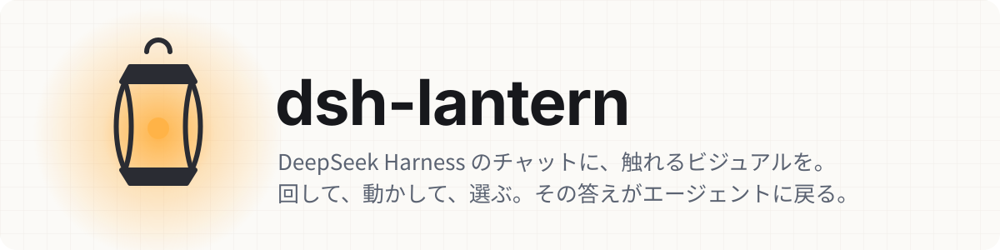
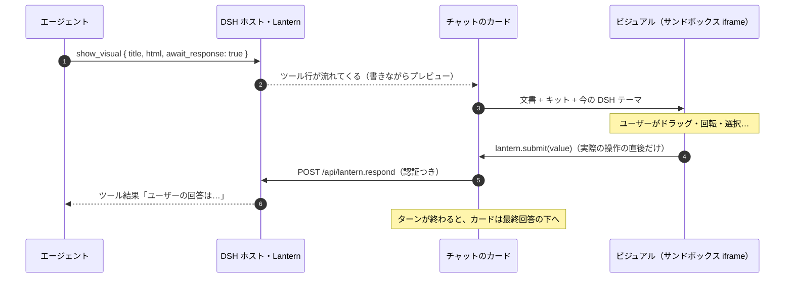

<p align="center">
  <picture>
    <source media="(prefers-color-scheme: dark)" srcset="docs/banner-ja-dark.svg">
    
  </picture>
</p>

<p align="center">
  <a href="README.md">English</a> · <b>日本語</b> · <a href="README.zh.md">简体中文</a>
</p>

<p align="center">
  
  
  
  
</p>

<p align="center">
  
</p>

**エージェントの答えを「読むもの」から「触れるもの」に。** ツールは `show_visual` ひとつだけ。HTML を [DeepSeek Harness](https://github.com/deepseek-ai/deepseek-harness) Web のチャットの中で動くカードにします。回せる 3D モデル、つついて試せるシミュレーション、範囲を選べるグラフ、ドラッグで並べ替えるリストを表示できます。エージェントがこの形で質問すれば、あなたのクリックがそのまま答えとして戻ります。

## ここが違う

- 🪟 **会話の中に残る。** カードは回答の下に表示され、ターンの経過が折りたたまれても残ります。ページを再読み込みしても、回答やスライダーの位置ごと戻ります。
- 🔁 **答えが戻る。** `await_response: true` ならエージェントは待ち、ユーザーが選んだもの、並べた順番、入力した内容がツール結果として返ります。「続きを聞く」ボタンはユーザーのメッセージとして送られます。
- 🎨 **DSH になじむ。** DSH のライト/ダーク・色・フォントをそのまま受け取り、切り替えにも再読み込みなしで即追従します。
- 🧰 **部品キットはあくまで出発点。** トークンと部品は CSS のカスケードレイヤーで先に読み込むので、ビジュアル側のフォント・色・レイアウトが必ず勝ちます。Three.js・D3・KaTeX・Chart.js も CDN からそのまま読み込めます。
- 🗂️ **手元の HTML も。** `path` でワークスペースのページを指定すると、相対パスの CSS・画像・モジュール・JSON ごとサイドバーに表示します。DSH Web が開ける場所ならどこでも使え、Cloudflare Tunnel 越しでも動きます。
- 🪶 **プロンプトを汚さない。** システムプロンプトには何も足しません。デザインガイドはスキル（`lantern-visuals`）として同梱し、モデルは必要なときだけ読みます。

## ギャラリー

どれも `show_visual` を 1 回呼んだだけのビジュアルです。画像をクリックするとソースが開きます。スクリーンショットは GitHub のテーマ（ライト/ダーク）に合わせて切り替わります。これらは Lantern でここまで表現できることを示すために書いたもので、実際の出来は使うモデルによって変わります。

<table>
<tr>
<td width="50%" valign="top">
<a href="examples/molecule.html"><picture><source media="(prefers-color-scheme: dark)" srcset="docs/gallery/molecule-dark.jpg"></picture></a><br>
<b>分子ビューア</b> <sub>three.js · チャット内</sub><br>
<sub>ドラッグで回転、原子をクリックして結合距離や角度を測定。球棒・空間充填を切り替え。水から C₆₀ まで 6 種類。</sub>
</td>
<td width="50%" valign="top">
<a href="examples/surface.html"><picture><source media="(prefers-color-scheme: dark)" srcset="docs/gallery/surface-dark.jpg"></picture></a><br>
<b>3D 関数サーフェス</b> <sub>three.js · KaTeX · サイドバー</sub><br>
<sub>数式つきの 5 種類の曲面。カーソル位置の接平面と勾配を表示し、クリックした点から勾配降下を実行。</sub>
</td>
</tr>
<tr>
<td width="50%" valign="top">
<a href="examples/solar.html"><picture><source media="(prefers-color-scheme: dark)" srcset="docs/gallery/solar-dark.jpg"></picture></a><br>
<b>太陽系オーラリー</b> <sub>three.js · サイドバー</sub><br>
<sub>実際の軌道要素から惑星を配置。日付スライダー、再生速度、惑星をクリックして追尾。</sub>
</td>
<td width="50%" valign="top">
<a href="examples/graph.html"><picture><source media="(prefers-color-scheme: dark)" srcset="docs/gallery/graph-dark.jpg"></picture></a><br>
<b>概念マップ</b> <sub>D3 · チャット内</sub><br>
<sub>機械学習の概念をつないだ力学グラフ。ドラッグで固定、検索、絞り込み、ズーム。「この概念を説明」でエージェントに質問。</sub>
</td>
</tr>
<tr>
<td width="50%" valign="top">
<a href="examples/pendulum.html"><picture><source media="(prefers-color-scheme: dark)" srcset="docs/gallery/pendulum-dark.jpg"></picture></a><br>
<b>二重振り子とカオス</b> <sub>canvas · チャット内</sub><br>
<sub>おもりをドラッグして初期位置を決める。0.001 rad だけ違う 3 つの振り子が別々の動きへ。ずれは対数グラフで。</sub>
</td>
<td width="50%" valign="top">
<a href="examples/pathfind.html"><picture><source media="(prefers-color-scheme: dark)" srcset="docs/gallery/pathfind-dark.jpg"></picture></a><br>
<b>経路探索</b> <sub>canvas · チャット内</sub><br>
<sub>壁やぬかるみを描いて、BFS・ダイクストラ・A*・貪欲法を再生、コマ送り、一斉比較。迷路の自動生成つき。</sub>
</td>
</tr>
<tr>
<td width="50%" valign="top">
<a href="examples/explorer.html"><picture><source media="(prefers-color-scheme: dark)" srcset="docs/gallery/explorer-dark.jpg"></picture></a><br>
<b>連動ダッシュボード</b> <sub>D3 · サイドバー</sub><br>
<sub>タイムラインや散布図をブラシで範囲選択、棒をクリック。すべてのグラフが互いに絞り込み合う。</sub>
</td>
<td width="50%" valign="top">
<a href="examples/matrix.html"><picture><source media="(prefers-color-scheme: dark)" srcset="docs/gallery/matrix-dark.jpg"></picture></a><br>
<b>2×2 行列と線形変換</b> <sub>KaTeX · チャット内</sub><br>
<sub>基底ベクトルをドラッグすると、行列・行列式・固有ベクトルがその場で更新。</sub>
</td>
</tr>
<tr>
<td width="50%" valign="top">
<a href="examples/hanoi.html"><picture><source media="(prefers-color-scheme: dark)" srcset="docs/gallery/hanoi-dark.jpg"></picture></a><br>
<b>ハノイの塔</b> <sub>DOM · チャット内</sub><br>
<sub>円盤をドラッグ＆ドロップで移動。「自動で解く」で再帰の手順をアニメーション。</sub>
</td>
<td width="50%" valign="top">
<a href="examples/ranking.html"><picture><source media="(prefers-color-scheme: dark)" srcset="docs/gallery/ranking-dark.jpg"></picture></a><br>
<b>ドラッグで優先順位</b> <sub>await_response · チャット内</sub><br>
<sub>容量ラインを見ながら並べ替え。決めた順番がツール結果としてエージェントに戻る。</sub>
</td>
</tr>
<tr>
<td width="50%" valign="top">
<a href="examples/shader.html"><picture><source media="(prefers-color-scheme: dark)" srcset="docs/gallery/shader-dark.jpg"></picture></a><br>
<b>流れる模様</b> <sub>WebGL2 · チャット内</sub><br>
<sub>カーソルで渦、クリックで波紋が広がる GPU シェーダー。配色を切り替えて PNG で保存。</sub>
</td>
</tr>
</table>

<table>
<tr>
<td width="50%"><br><sub>概念マップを引っぱって動かし、気になるノードをエージェントに質問。</sub></td>
<td width="50%"><br><sub>壁を描いて、A* が道を見つけるまでを見る。</sub></td>
</tr>
<tr>
<td colspan="2"><br><sub>ドラッグで並べて決定すると、エージェントがその順番で続きを進める。</sub></td>
</tr>
</table>

## すぐ使う

```sh
dsh plugin --profile web add github:Aero123421/dsh-lantern
# その後 `dsh web` を再起動
```

必要なのは DSH 0.2.1 以降（0.2 系）の Web プロファイルです。バージョンタグを push すると、GitHub の Release に `dsh-lantern-<version>.tgz` と `SHA256SUMS` が付きます（タグを push するまでは公開されません）。チェックサムを確かめてからアーカイブを入れます。

```sh
sha256sum -c SHA256SUMS
dsh plugin --profile web add ./dsh-lantern-0.2.1.tgz
```

読み込まれたかは `dsh --profile web --dump-config | grep lantern` で確認できます。

あとは頼むだけです。たとえば:

- 「カフェインってどんな形？ 回して見られるようにして」
- 「勾配降下法を、触れる 3D の曲面で説明して」
- 「A\* とダイクストラを、壁を描けるグリッドで比べたい」
- 「今スプリントのチケット、ドラッグで優先順位をつけさせて」
- 「`report/index.html` をサイドバーで開いて」

## しくみ



## モデル向け: `show_visual` ツール

| 引数 | |
|---|---|
| `title` | カードとタブの見出し（必須） |
| `html` | 断片でも完全な文書でも可。キットとテーマは読み込み済み |
| `path` | `html` の代わりにワークスペースの `.html`。常にサイドバーで開く |
| `display` | `inline`（既定）か `panel`（右サイドバー） |
| `await_response` | ユーザーの回答を待って結果として返す |
| `replace` | 修正版として置き換える以前のビジュアルの `id`。古いカードは新しい版へのリンクに畳まれる |

ビジュアルの中では `window.lantern`（`submit`・`send`・`setState` / `getState`・`expand`・`openLink`・`colors()`・`visible`・イベント）が使えます。よくある操作はスクリプトなしでも書けます: `data-lt-choices`・`data-lt-submit`・`data-lt-form`・`data-lt-send`・`data-lt-fullscreen`・タブ・ステップ。書き方の全体（パターン・3D・操作）は [`skills/lantern-visuals`](skills/lantern-visuals/SKILL.md) にあります。

<details>
<summary><b>見た目は自由自在: キットはあくまで出発点</b></summary>

トークンはすべて上書きでき、自分で書いたスタイルが必ずキットに勝ちます。

```html
<style>
  :root {
    --lt-font: "Iowan Old Style", var(--lt-font-serif);
    --lt-accent: #e8590c;
    --lt-radius: 18px;
  }
  :root[data-theme="dark"] { --lt-accent: #ff922b; }
</style>
<div class="lt-card raised lt-stack">
  <h3>見た目は自分で、仕組みはキットで</h3>
  <button class="primary" data-lt-submit='"ok"'>これでいこう</button>
</div>
```

トークンはフォント・文字サイズ・面・文字色・枠線・強調色・成功/警告/危険・8 色の系列色・角丸・余白・影・動きまで揃っています。詳しくは [`references/kit.md`](skills/lantern-visuals/references/kit.md)。

</details>

## ワークスペースのページ

`path: "report/index.html"` で、作業ディレクトリの実ファイルをサイドバーのタブに開きます。フォルダ単位で期限つきのリンクから配信するので、そのフォルダ内の相対パス `<link>`・``・`<script type="module">`・`fetch()` は普通の静的サーバーと同じように動きます。ほかのサイトへの `fetch`・XHR・画像・CSS の `url()`・フォーム・prefetch・WebSocket・`sendBeacon`・遷移は拒否します。ページの見た目はそのままに、`window.lantern` と `--lt-*` のテーマ変数も使えます。`<meta name="lantern-kit">` を書けばキットの部品も使えます。


## 安全性

ビジュアルはモデルが書いたコードなので、Lantern は信頼せずに扱います。

- **隔離。** ビジュアルはサンドボックス化した iframe（`allow-scripts allow-forms allow-downloads`、`allow-same-origin` は付けない）で動きます。オリジンを持たないので、DSH の Cookie・DOM・API には届きません。外への出口はカードへの `postMessage` だけで、送り主も確認します。
- **決めるのはユーザー。** 回答・メッセージ・リンク・サイドバー表示の要求は、そのビジュアルの中でユーザーが実際に操作した直後だけ受け付けます。回答は 1 ビジュアル 1 回で、続きのメッセージは間隔と回数に上限があります。
- **外へ漏らさない。** HTML ビジュアルとワークスペースのページは、外部への `fetch`・XHR・`sendBeacon`・WebSocket・画像・CSS の `url()`・スタイルシート・prefetch/preload・フォーム送信・`<base>`・遷移を拒否します。ページが自分で作る `data:` と `blob:` の画像は使えます。HTML ビジュアルは `<script src="https://…">` でライブラリを読み込めます。書いている途中のプレビューでは、スクリプト・イベント属性・`javascript:` URL・埋め込みフレームを取り除きます。
- **開き直したカードは止まったまま。** スクリプトが勝手に動くのは、そのビジュアルを作ったページで最初に表示されたときだけです。会話を開き直したとき、ページを再読み込みしたとき、回答待ちのまま再読み込みしたカードは、実行を押すまで止まります。無限ループは最初の表示で固めることがあります。再読み込みすれば DSH は戻り、そのループはもう動きません。
- **ファイルは範囲内だけ。** ワークスペースのリンクはランダムで、そのページのフォルダだけを対象にし、8 時間で失効し、DSH の認証済み API からしか発行されません。シンボリックリンクは解決し、開いたファイルでもう一度確かめます。隠しファイル・隠しフォルダは拒否します。

## 設定

任意です。プロファイルの `cordis.patch.yml` に書きます。

```yaml
- id: dsh-lantern
  config:
    answerTimeoutMinutes: 15   # 回答を待つ時間（既定 15 分、最大 1440）
    maxHtmlChars: 400000       # html 引数の上限（既定 400000 文字）
```

## 開発

```sh
npm install
npm run check                                       # 型チェック・テスト・ビルド（lib/ を生成）
dsh plugin --profile web add /path/to/dsh-lantern   # 手元のフォルダをリンク
```

GitHub から入れるときにビルドが要らないよう、`lib/` はコミットしています。ホスト側は Node の ESM です。ブラウザ側は DSH Web のモジュールローダーから読み込まれ、DSH の React を共有します。実行時に DSH のパッケージは import しません。

## これから

- UI 確認のための GIF・動画の取り込み
- MCP Apps サーバーの UI 表示
- タッチ画面での 3D カードの二本指操作

## ライセンス

MIT。Lantern は非公式のコミュニティ製プラグインで、DeepSeek とは関係ありません。
