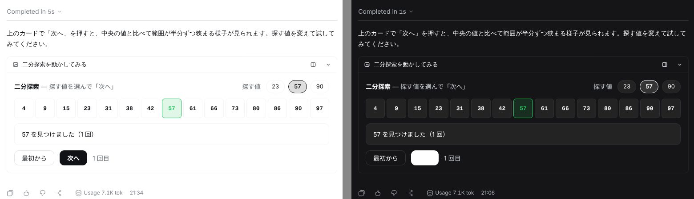
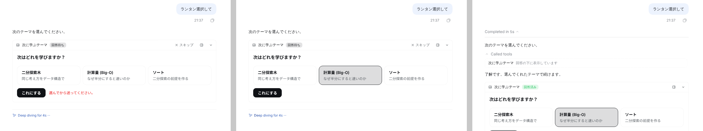
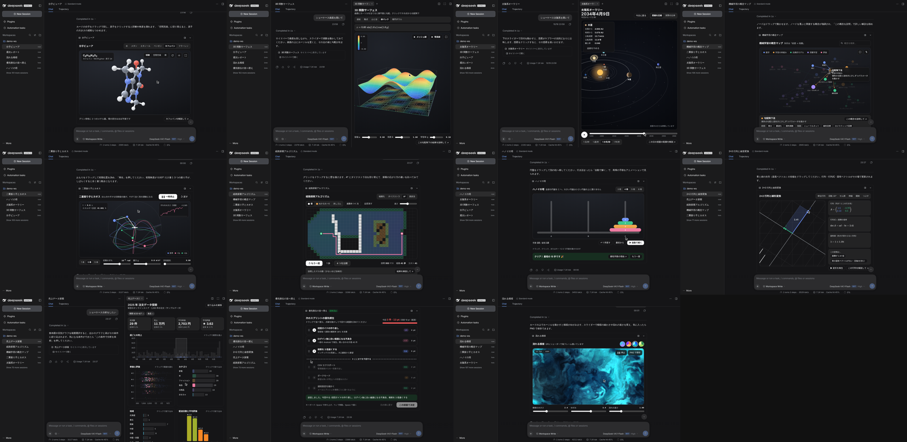

# dsh-lantern

[DeepSeek Harness](https://github.com/deepseek-ai/deepseek-harness)（DSH）Web のチャットとサイドバーに、触れる HTML ビジュアルを出すプラグインです。ユーザーの回答はエージェントに戻ります。非公式。

[English](README.md)



- **チャットの中に表示。** 図解・動かせる説明・グラフ・選択カード・短いフォームを、サンドボックス化したカードで表示します。ターンが終わって経過が折りたたまれても、カードは最終回答の下に残ります。
- **サイドバーに表示。** `display: "panel"` でサイドバーのタブとして開きます。チャットのカードからも広げられます。
- **ワークスペースの HTML。** `path` で作業ディレクトリ内の `.html` をサイドバーに表示します。ページのフォルダ内なら相対パスの画像・CSS・モジュール JS・`fetch()` がそのまま動きます。DSH Web と同じアドレス（Cloudflare Tunnel 経由も）で見られます。
- **回答が戻る。** `await_response: true` ならエージェントは待ち、ユーザーの回答をツール結果として受け取ります。待たない場合、回答や「続きを聞く」ボタンはユーザーの次のメッセージとして届きます。
- **DSH に合わせる。** DSH のライト/ダーク・色・フォントを各ビジュアルに渡し、切り替えにも即追従します。
- **触って動かすためのつくり。** 3D・シミュレーション・ドラッグで動かす図・ゲームがカードの中で動きます。ビジュアルをクリックするまでホイールはチャットのスクロールに使われます。カードに専用スクロールバーが出てガタつくことはなく、ビューポート基準のページも際限なく伸びずに高さが固定されます。`lantern.visible` で画面外ではアニメーションを止められ、WebGL が失われたカードには「再開」が出ます。全画面表示とファイル保存もできます。
- **部品キットはあくまで出発点。** トークンと部品は CSS のカスケードレイヤーで先に読み込むので、ビジュアル側が書いたフォント・色・レイアウトが必ず勝ちます。
- **システムプロンプトではなくスキル。** デザインガイドは `lantern-visuals` スキルとして同梱し、モデルが必要なときに読みます。システムプロンプトには何も足さず、ツール説明も短くしています。




## ショーケース




[`examples/`](examples) に 11 個のショーケース（three.js の分子ビューア・3D 曲面・太陽系、二重振り子、D3 の概念マップ、経路探索、連動するダッシュボード、行列、ハノイの塔、並べ替え回答、WebGL シェーダー）があります。モデルが `html` として渡す形のまま置いています。

## インストール

DSH 0.2.1 以降（0.2 系）、Web プロファイル。

```sh
dsh plugin --profile web add github:Aero123421/dsh-lantern#v0.2.0
# ダウンロードしたパッケージから
dsh plugin --profile web add ./dsh-lantern-0.2.0.tgz
```

`dsh web` を再起動してください。`dsh --profile web --dump-config | grep lantern` で確認できます。

設定（任意。プロファイルの `cordis.patch.yml`）:

```yaml
- id: dsh-lantern
  config:
    answerTimeoutMinutes: 15   # 回答を待つ時間（既定 15 分）
    maxHtmlChars: 400000       # html 引数の上限（既定 400000 文字）
```

## ツール

`show_visual`

| 引数 | |
|---|---|
| `title` | カードとタブの見出し（必須） |
| `html` | 断片でも完全な HTML 文書でも可 |
| `path` | `html` の代わりにワークスペースの `.html`（常にサイドバー） |
| `display` | `inline`（既定）か `panel` |
| `await_response` | ユーザーの回答を待って結果として返す |
| `replace` | 修正版として置き換える以前のビジュアルの `id`。古いカードは新しい版へのリンクに畳まれます |

ビジュアルの中では `window.lantern`（`submit`・`send`・`setState`/`getState`・`expand`・`openLink`・`colors()`・`visible`・イベント）と、宣言的な属性（`data-lt-choices`・`data-lt-submit`・`data-lt-form`・`data-lt-send`・`data-lt-fullscreen`・タブ・ステップ）が使えます。詳しくは [`skills/lantern-visuals`](skills/lantern-visuals/SKILL.md)。

## 安全性

- ビジュアルは `sandbox="allow-scripts allow-forms allow-downloads"`（`allow-same-origin` なし）の iframe で動きます。DSH の Cookie・DOM・API には触れられず、カードへの `postMessage` だけが出口で、送り主も確認します。
- 回答・メッセージ送信・リンク・サイドバー表示の要求は、そのビジュアルの中でユーザーが実際に操作した直後だけ受け付けます（フォーカスがあり、それが DSH 側での最後の入力より後に移っていて、ブラウザが新しいユーザー操作を報告していること）。回答は 1 ビジュアル 1 回、続きのメッセージは間隔と回数に上限があります。
- HTML ビジュアルには `fetch`・XHR・WebSocket・フォーム送信・`<base>` を禁じる CSP を付けるので、入力した内容が外へ送られません。書いている途中のプレビューでは、スクリプト・イベント属性・`javascript:` URL・埋め込みフレームを取り除きます。
- ワークスペースのページは `/lantern/files/<トークン>/…` から配信します。トークンはランダムで、そのページのフォルダとその下だけを対象にし、発行から 8 時間で失効し、DSH の認証済み API からしか発行されません。シンボリックリンクは解決し、開いたファイルでもう一度確かめます。隠しファイル・隠しフォルダは拒否します。応答には `Content-Security-Policy: sandbox allow-scripts allow-forms allow-downloads` と `Referrer-Policy: no-referrer` を付けます。
- 回答はセッションと呼び出し ID の組で、待っている呼び出しに結び付けます。
- HTML ビジュアルは CDN からスクリプトを読み込めますが、サンドボックスの外には出られません。

## 開発

```sh
npm install
npm run check      # 型チェック・テスト・ビルド（lib/ を生成）
dsh plugin --profile web add /path/to/dsh-lantern   # フォルダをリンク
```

GitHub から入れたときにビルド不要になるよう、`lib/` はコミットしています。

## 今回やらないこと

GIF・動画、MCP Apps の UI、ポート転送、サーバー側ブラウザは 0.1 の対象外です。

## ライセンス

MIT
