<p align="center">
  <picture>
    <source media="(prefers-color-scheme: dark)" srcset="docs/banner-dark.svg">
    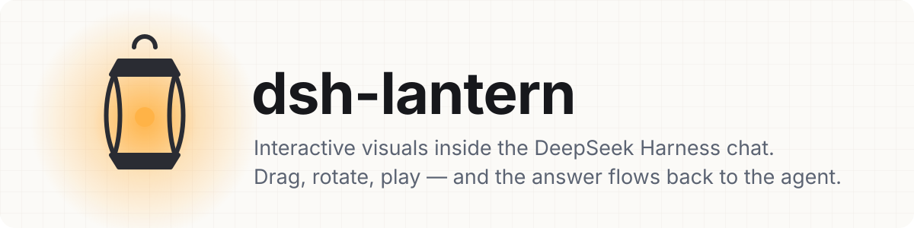
  </picture>
</p>

<p align="center">
  <b>English</b> · <a href="README.ja.md">日本語</a> · <a href="README.zh.md">简体中文</a>
</p>

<p align="center">
  
  
  
  
</p>

<p align="center">
  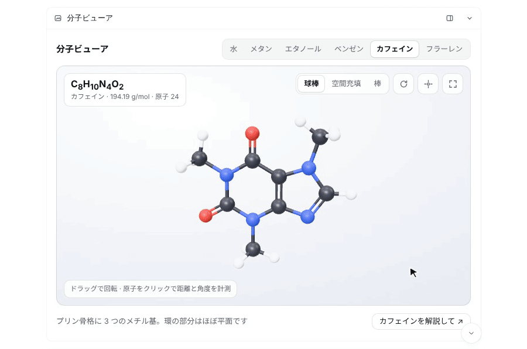
</p>

**Lantern lets the agent answer with something you can touch.** One tool, `show_visual`, turns HTML into a live card in the [DeepSeek Harness](https://github.com/deepseek-ai/deepseek-harness) Web chat: a 3D model you rotate, a simulation you poke, a chart you brush, a list you drag into order. When the agent asks a question this way, your click comes straight back to it as the answer.

## Why it feels different

- 🪟 **It lives in the conversation.** Cards render under the reply and stay there after the turn folds away. Recorded answers return with the conversation; visuals can save inputs for restoration in the same browser.
- 🔁 **Answers flow back.** With `await_response: true` the agent waits, and whatever the user picks, ranks or types returns as the tool result. Follow-up buttons post a message as the user.
- 🎨 **It looks like DSH.** The live DSH theme (light or dark, colours, fonts) flows into every visual and switches instantly, with no reload.
- 🧰 **A kit, not a cage.** Tokens and components are preloaded in CSS cascade layers, so a visual can supply its own fonts, colours and layout. Three.js, D3, KaTeX and Chart.js can load from `cdn.jsdelivr.net/npm/`.
- 🗂️ **Your HTML files, too.** Point `path` at a page on the DSH host's local workspace and it opens in the sidebar with its relative CSS, images, modules and JSON.
- 🪶 **Useful visuals without loading a skill.** A short, optional system prompt encourages the agent to choose a visual when it helps. The tool description includes the essentials; the bundled `lantern-visuals` skill is an optional advanced guide.

## Gallery

Eleven showcase visuals, each a single `show_visual` call. Click a picture to see its source; the screenshots follow your GitHub theme. They were written to show what Lantern can carry. Your own results depend on the model you run.

<table>
<tr>
<td width="50%" valign="top">
<a href="examples/molecule.html"><picture><source media="(prefers-color-scheme: dark)" srcset="docs/gallery/molecule-dark.jpg">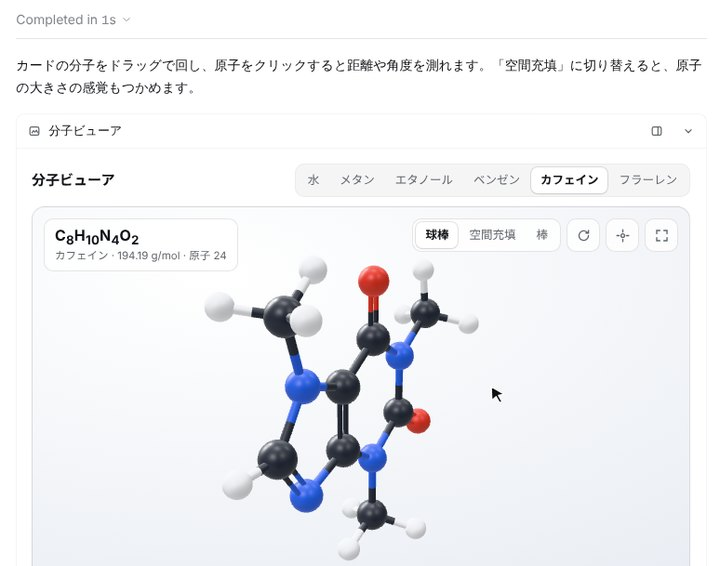</picture></a><br>
<b>Molecule viewer</b> <sub>three.js · in the chat</sub><br>
<sub>Drag to rotate, click atoms to measure bond lengths and angles, switch ball-and-stick / space-filling. Six molecules up to C₆₀.</sub>
</td>
<td width="50%" valign="top">
<a href="examples/surface.html"><picture><source media="(prefers-color-scheme: dark)" srcset="docs/gallery/surface-dark.jpg">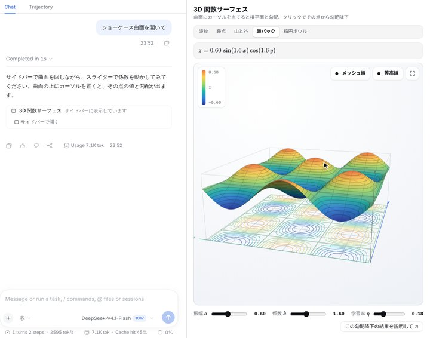</picture></a><br>
<b>3D function surface</b> <sub>three.js · KaTeX · in the sidebar</sub><br>
<sub>Five functions with live formulas. Hover for the tangent plane and gradient, click to run gradient descent from that point.</sub>
</td>
</tr>
<tr>
<td width="50%" valign="top">
<a href="examples/solar.html"><picture><source media="(prefers-color-scheme: dark)" srcset="docs/gallery/solar-dark.jpg">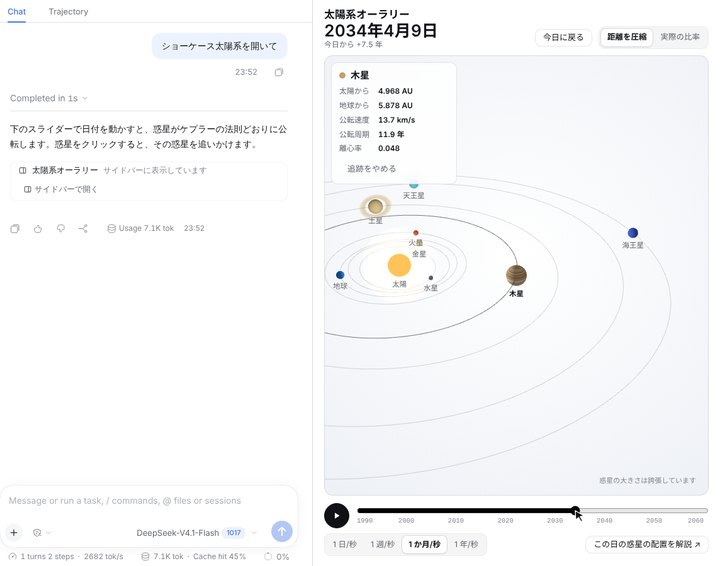</picture></a><br>
<b>Orrery</b> <sub>three.js · in the sidebar</sub><br>
<sub>Planets placed from real orbital elements. Scrub the date, play at any speed, click a planet to follow it.</sub>
</td>
<td width="50%" valign="top">
<a href="examples/graph.html"><picture><source media="(prefers-color-scheme: dark)" srcset="docs/gallery/graph-dark.jpg">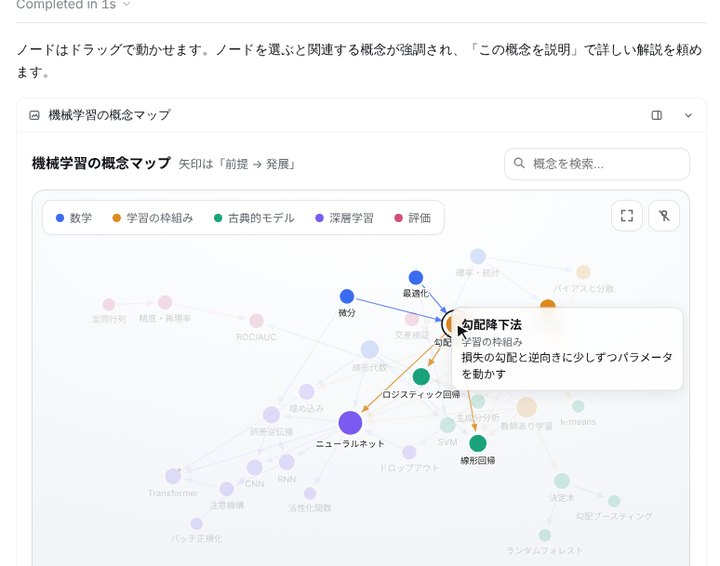</picture></a><br>
<b>Concept map</b> <sub>D3 · in the chat</sub><br>
<sub>Force-directed graph of ML concepts: drag to pin, search, filter, zoom. "Explain this concept" asks the agent.</sub>
</td>
</tr>
<tr>
<td width="50%" valign="top">
<a href="examples/pendulum.html"><picture><source media="(prefers-color-scheme: dark)" srcset="docs/gallery/pendulum-dark.jpg">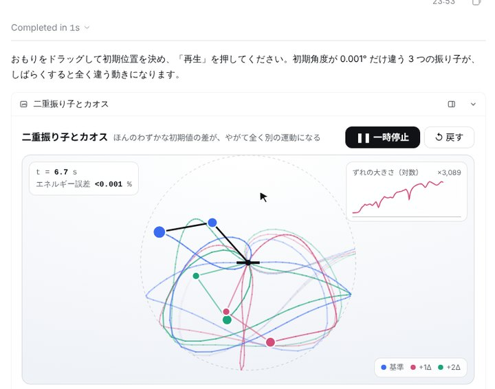</picture></a><br>
<b>Double pendulum</b> <sub>canvas · in the chat</sub><br>
<sub>Drag the bobs to set the start. Three copies 0.001 rad apart drift into chaos, with a log-scale divergence chart.</sub>
</td>
<td width="50%" valign="top">
<a href="examples/pathfind.html"><picture><source media="(prefers-color-scheme: dark)" srcset="docs/gallery/pathfind-dark.jpg">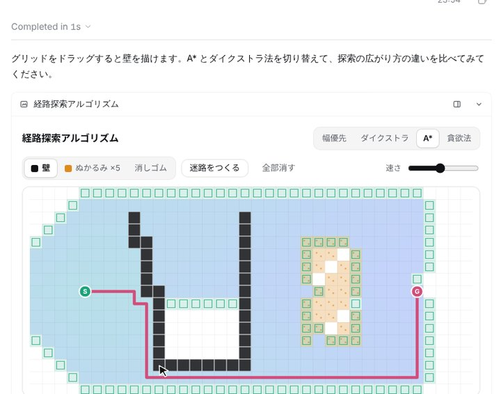</picture></a><br>
<b>Pathfinding</b> <sub>canvas · in the chat</sub><br>
<sub>Draw walls and mud, then play, step or race BFS, Dijkstra, A* and greedy search. Includes a maze generator.</sub>
</td>
</tr>
<tr>
<td width="50%" valign="top">
<a href="examples/explorer.html"><picture><source media="(prefers-color-scheme: dark)" srcset="docs/gallery/explorer-dark.jpg">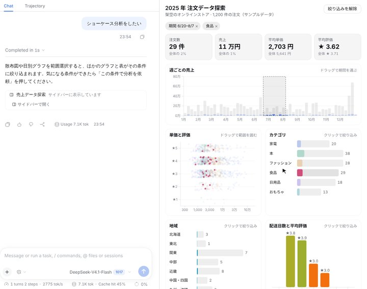</picture></a><br>
<b>Linked dashboard</b> <sub>D3 · in the sidebar</sub><br>
<sub>Brush the timeline or the scatter plot, click bars — every chart filters every other one.</sub>
</td>
<td width="50%" valign="top">
<a href="examples/matrix.html"><picture><source media="(prefers-color-scheme: dark)" srcset="docs/gallery/matrix-dark.jpg">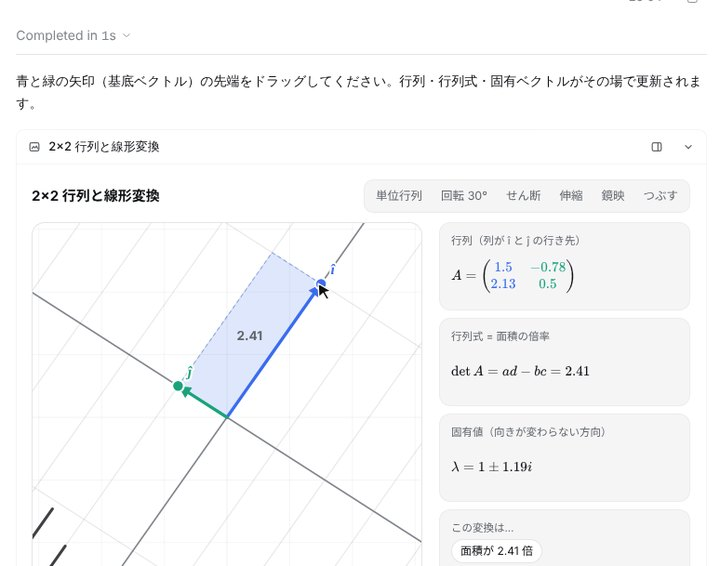</picture></a><br>
<b>Matrix explorer</b> <sub>KaTeX · in the chat</sub><br>
<sub>Drag the basis vectors and watch the matrix, determinant and eigenvectors update live.</sub>
</td>
</tr>
<tr>
<td width="50%" valign="top">
<a href="examples/hanoi.html"><picture><source media="(prefers-color-scheme: dark)" srcset="docs/gallery/hanoi-dark.jpg">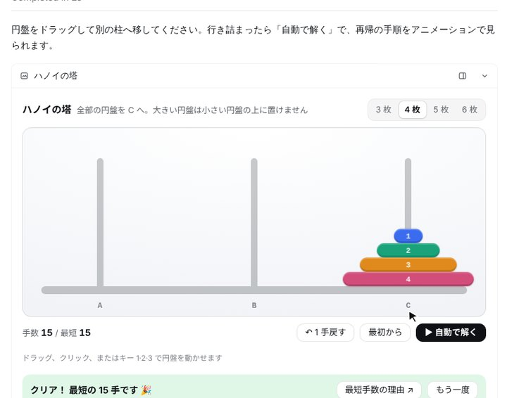</picture></a><br>
<b>Tower of Hanoi</b> <sub>DOM · in the chat</sub><br>
<sub>Drag and drop the discs, or let auto-solve show the recursion move by move.</sub>
</td>
<td width="50%" valign="top">
<a href="examples/ranking.html"><picture><source media="(prefers-color-scheme: dark)" srcset="docs/gallery/ranking-dark.jpg">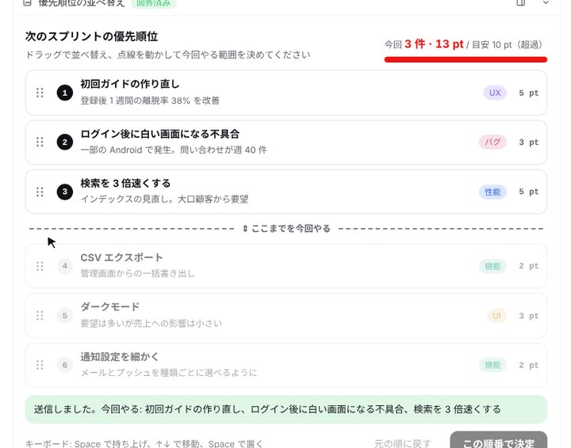</picture></a><br>
<b>Drag-to-rank answer</b> <sub>await_response · in the chat</sub><br>
<sub>Sort the backlog against a capacity line. The final order returns to the agent as the tool result.</sub>
</td>
</tr>
<tr>
<td width="50%" valign="top">
<a href="examples/shader.html"><picture><source media="(prefers-color-scheme: dark)" srcset="docs/gallery/shader-dark.jpg">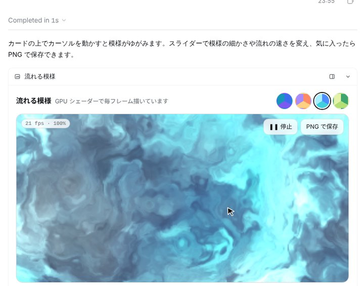</picture></a><br>
<b>Generative shader</b> <sub>WebGL2 · in the chat</sub><br>
<sub>A flowing GPU pattern that swirls under the cursor and ripples on click. Switch palettes, save a PNG.</sub>
</td>
</tr>
</table>

<table>
<tr>
<td width="50%">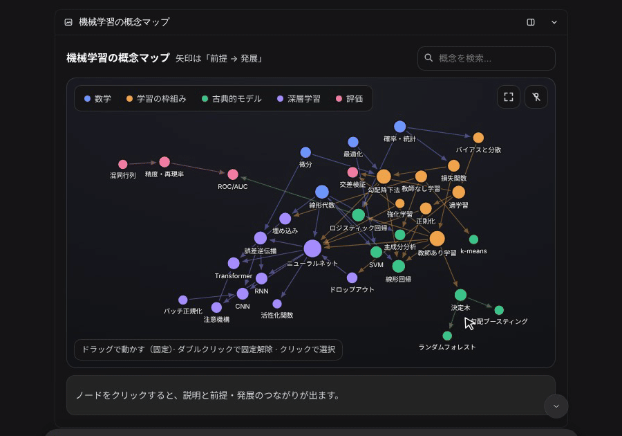<br><sub>Drag a concept map, then ask the agent about a node.</sub></td>
<td width="50%">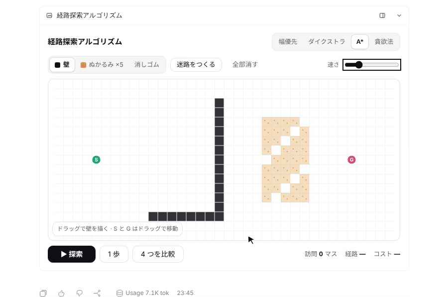<br><sub>Draw walls and watch A* find its way.</sub></td>
</tr>
<tr>
<td colspan="2">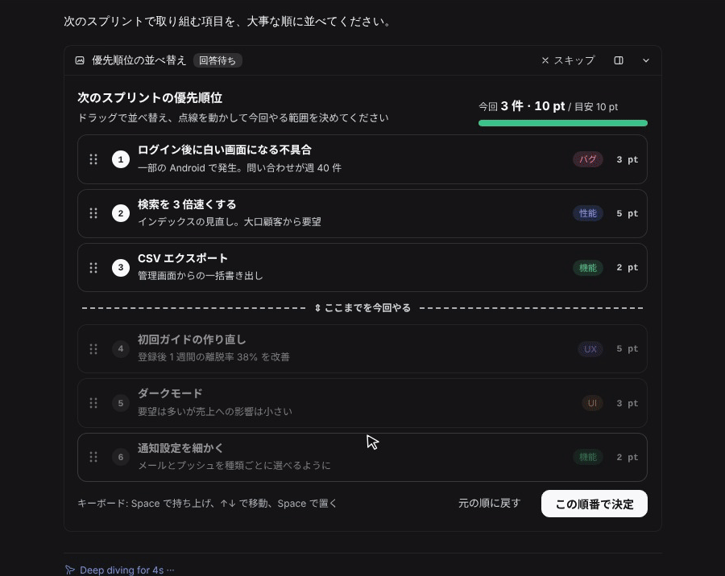<br><sub>Rank by dragging, press the button, and the agent continues with your order.</sub></td>
</tr>
</table>

## Quick start

```sh
dsh plugin --profile web add github:Aero123421/dsh-lantern
# then restart `dsh web`
```

Use the Web profile with DSH `>=0.2.1-rc.2 <0.3.0-0`. This version was tested with the prerelease DSH `0.2.1-rc.2`. You can also install the `.tgz` from a release. Check that it loaded with `dsh --profile web --dump-config | grep lantern`.

Then just ask. For example:

- *"How is caffeine shaped? Show me something I can rotate."*
- *"Explain gradient descent with a 3D surface I can play with."*
- *"Compare A\* and Dijkstra on a grid I can draw walls on."*
- *"Here are this sprint's tickets. Let me drag them into priority order."*
- *"Open `report/index.html` in the sidebar."*

## Automatic conversation visuals

Open **Plugins → dsh-lantern → Use conversation visuals automatically**. It is on by default. Changes save automatically and apply when DSH assembles the prompt for its next model step; no restart or skill loading is needed.

When enabled, Lantern registers [102 English words of guidance](src/host/prompt.ts) in the system prompt layer. It encourages compact cards for explanation, comparison and exploration, local responses to controls, and deliberate submission back to the conversation. Simple answers can stay in prose. This guidance is independent of SKILLS content. The token count depends on the model's tokenizer; tool descriptions also occupy context. The bundled advanced guide is excluded from the automatic skill catalog and can be loaded explicitly by starting a message with `/lantern-visuals`.

Turning this setting off removes that guidance and keeps `show_visual` available for direct requests. Disabling the whole plugin in Plugins unloads its tools, routes, prompt section and UI. The optional design guide is never a prerequisite for using the tool.

## How it works

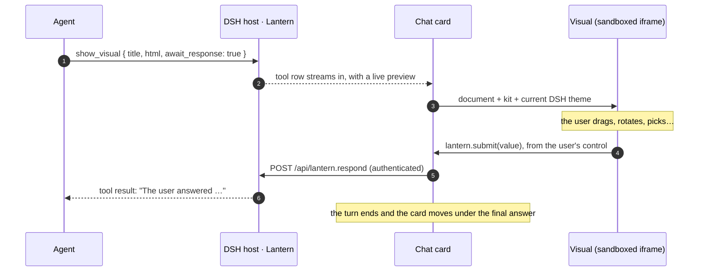

## For the model: the `show_visual` tool

| Argument | |
|---|---|
| `title` | Card and tab title (required). |
| `html` | A fragment or a complete document. The kit and theme are preloaded. |
| `path` | A workspace `.html` file instead of `html`. It always opens in the sidebar. |
| `display` | `inline` (default) or `panel` (the right sidebar). |
| `await_response` | Wait for the user's answer and return it as the result. |
| `replace` | The `id` of an earlier visual that this one revises. The old card folds into a link to the new one. |

Pass exactly one of `html` or `path`. Inside a visual, `window.lantern` offers `submit`, `send`, `setState` / `getState`, `expand`, `openLink`, `colors()`, `visible` and events. Declarative attributes cover the common cases without script: `data-lt-choices`, `data-lt-submit`, `data-lt-form`, `data-lt-send`, `data-lt-fullscreen`, tabs and steps. The optional advanced guide (patterns, 3D, interaction) is in [`skills/lantern-visuals`](skills/lantern-visuals/SKILL.md).

<details>
<summary><b>Make it yours: the kit is only a starting point</b></summary>

Every token can be overridden, and your own styles always beat the kit:

```html
<link rel="stylesheet" href="https://fonts.googleapis.com/css2?family=Zen+Maru+Gothic:wght@500;700&display=swap">
<style>
  :root {
    --lt-font: "Zen Maru Gothic", var(--lt-font-sans);
    --lt-accent: #e8590c;
    --lt-radius: 18px;
  }
  :root[data-theme="dark"] { --lt-accent: #ff922b; }
</style>
<div class="lt-card raised lt-stack">
  <h3>Your look, the kit's plumbing</h3>
  <button class="primary" data-lt-submit='"ok"'>Sounds good</button>
</div>
```

The tokens cover fonts, sizes, surfaces, text, borders, accent, success/warning/danger, eight series colours, radius, spacing, shadow and motion. See [`references/kit.md`](skills/lantern-visuals/references/kit.md).

</details>

## Workspace pages

`path: "report/index.html"` opens a real file from the DSH host's local working directory in a sidebar tab. Relative styles, images, module scripts and `fetch()` of files in the page's folder or its subfolders are supported. The page keeps its own look, receives `window.lantern` and the `--lt-*` theme tokens, and can opt into the kit's components with `<meta name="lantern-kit">`. In module scripts, resolve data with `new URL('data.json', import.meta.url)`.

The original directory and entry path are recorded when the tool runs. Reopening the card reads that file from its original directory, even if the session's working directory has changed. This is a live file, not a snapshot: edits appear when the page is loaded again, and moved or deleted files cannot be reopened. Remote execution filesystems are unsupported; pass `html` with embedded data instead. Old `path` cards created before Lantern `0.3.0` without saved source metadata need to be created again.

If a workspace page navigates its own iframe or calls `location.reload()`, its Lantern connection is not carried into the new document. Close its sidebar tab and reopen it from the chat, or reload DSH, to restore the connection and available saved state.

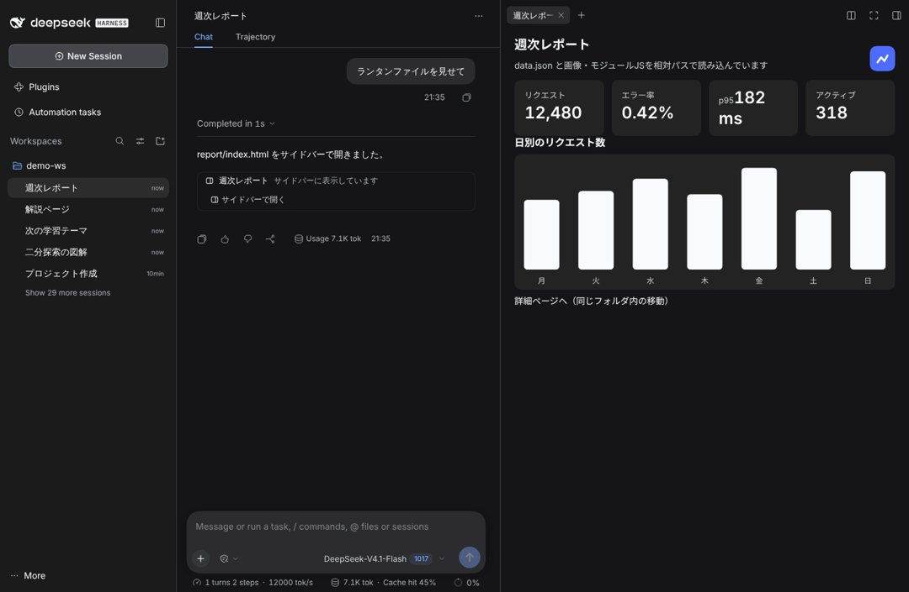

## Saved inputs and answers

Use `lantern.setState()` / `getState()` to restore a visual's inputs when it is recreated. State is stored in this browser's `localStorage` on a best-effort basis, for up to 300 visuals. It is not synced between devices. Clearing browser data or storage limits can remove it; if storage is unavailable, it lasts only for the current page.

For `await_response: true`, the host settles a pending wait once. Once answered, dismissed or closed, further submissions are rejected. Completed answers are also recorded in the conversation. Non-awaited submissions, including late answers after a timeout, become new user messages. These messages do not have an exactly-once guarantee across browsers.

## Safety

A visual is model-written code, so Lantern treats it as untrusted:

- **Browser isolation.** Visuals run in a sandboxed iframe (`allow-scripts allow-forms allow-downloads`, without `allow-same-origin`). The opaque origin prevents direct access to DSH's DOM, cookies and browser storage. The card validates the sender of bridge messages and limits follow-up messages.
- **User actions.** Answers, follow-ups, external links and sidebar requests require recent browser user activation inside the visual. The bridge uses a private channel for each document. User activation does not verify that generated controls are honestly labelled or that submitted data matches what they display.
- **Restricted resource loading.** A CSP is placed before the visual's markup. Scripts and styles can load from `https://cdn.jsdelivr.net/npm/`; Google Fonts styles and fonts are also allowed. HTML visuals must embed data and images: external `fetch`, XHR, WebSockets, images and media are blocked. Nested frames, workers, objects, form posts and `<base>` are blocked. The streaming preview also filters active markup and uses a script nonce so model scripts cannot run during the preview.
- **Workspace access.** File pages additionally allow resource requests to their serving origin so relative assets and `fetch()` work. File links use random tokens, cover the page's folder and its subfolders, and expire after 8 hours. DSH's authenticated API issues the links; possession of a link grants access within that scope. Symlinks are resolved and re-checked on the opened file, and hidden files and folders are refused.

These controls do not provide complete network isolation for arbitrary HTML. Allowed hosts still receive requests, a visual can navigate its own iframe, and a workspace page's CSP allows its serving origin rather than an individual folder. Do not put secrets in visual code or in a shared page's folder.

## Configuration

Use the Plugins toggle for automatic visuals. You can also configure defaults in your profile's `cordis.patch.yml`:

```yaml
- id: dsh-lantern
  config:
    automaticVisuals: true     # optional system guidance; change live in Plugins
    answerTimeoutMinutes: 15   # how long an awaited visual waits (default 15, max 1440)
    maxHtmlChars: 400000       # the largest html argument (default 400000)
```

Advanced: DSH prompt presets marked `complete: true` replace the assembled prompt. Lantern respects that choice and does not append its guidance to a complete preset.

## Development

```sh
npm install
npm run check                                       # typecheck, tests, build → lib/
dsh plugin --profile web add /path/to/dsh-lantern   # link your checkout
```

`lib/` is committed, so a GitHub install needs no build step. The host half is Node ESM and imports `@deepseek-ai/schemastery` at runtime for its settings schema. The browser half loads through DSH Web's module loader and shares DSH's React runtime.

## Roadmap

- GIF and video capture for UI checks
- Rendering UIs from MCP Apps servers
- Two-finger gestures for 3D cards on touch screens

## License

MIT. Lantern is an unofficial community plugin and is not affiliated with DeepSeek.
