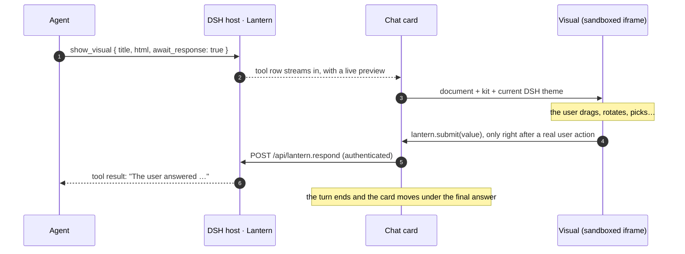

<p align="center">
  <picture>
    <source media="(prefers-color-scheme: dark)" srcset="docs/banner-dark.svg">
    
  </picture>
</p>

<p align="center">
  <b>English</b> · <a href="README.ja.md">日本語</a> · <a href="README.zh.md">简体中文</a>
</p>

<p align="center">
  
  
  
  
</p>

<p align="center">
  
</p>

**Lantern lets the agent answer with something you can touch.** One tool, `show_visual`, turns HTML into a live card in the [DeepSeek Harness](https://github.com/deepseek-ai/deepseek-harness) Web chat: a 3D model you rotate, a simulation you poke, a chart you brush, a list you drag into order. When the agent asks a question this way, your click comes straight back to it as the answer.

## Why it feels different

- 🪟 **It lives in the conversation.** Cards render under the reply and stay there after the turn folds away. Reload the page and they come back, answers and slider positions included.
- 🔁 **Answers flow back.** With `await_response: true` the agent waits, and whatever the user picks, ranks or types returns as the tool result. Follow-up buttons post a message as the user.
- 🎨 **It looks like DSH.** The live DSH theme (light or dark, colours, fonts) flows into every visual and switches instantly, with no reload.
- 🧰 **A kit, not a cage.** Tokens and components are preloaded in CSS cascade layers, so a visual's own fonts, colours and layout always win. Three.js, D3, KaTeX and Chart.js load straight from a CDN.
- 🗂️ **Your HTML files, too.** Point `path` at a page in the workspace and it opens in the sidebar with its relative CSS, images, modules and JSON. It works wherever DSH Web does, including behind a Cloudflare Tunnel.
- 🪶 **Zero prompt tax.** Nothing is added to the system prompt. The design guide is a skill (`lantern-visuals`) that the model loads only when it needs it.

## Gallery

Eleven showcase visuals, each a single `show_visual` call. Click a picture to see its source; the screenshots follow your GitHub theme. They were written to show what Lantern can carry. Your own results depend on the model you run.

{{GALLERY}}

<table>
<tr>
<td width="50%"><br><sub>Drag a concept map, then ask the agent about a node.</sub></td>
<td width="50%"><br><sub>Draw walls and watch A* find its way.</sub></td>
</tr>
<tr>
<td colspan="2"><br><sub>Rank by dragging, press the button, and the agent continues with your order.</sub></td>
</tr>
</table>

## Quick start

```sh
dsh plugin --profile web add github:Aero123421/dsh-lantern
# then restart `dsh web`
```

This needs DSH 0.2.1 or later (0.2.x) with the Web profile. You can also install the `.tgz` from a release. Check that it loaded with `dsh --profile web --dump-config | grep lantern`.

Then just ask. For example:

- *"How is caffeine shaped? Show me something I can rotate."*
- *"Explain gradient descent with a 3D surface I can play with."*
- *"Compare A\* and Dijkstra on a grid I can draw walls on."*
- *"Here are this sprint's tickets. Let me drag them into priority order."*
- *"Open `report/index.html` in the sidebar."*

## How it works



## For the model: the `show_visual` tool

| Argument | |
|---|---|
| `title` | Card and tab title (required). |
| `html` | A fragment or a complete document. The kit and theme are preloaded. |
| `path` | A workspace `.html` file instead of `html`. It always opens in the sidebar. |
| `display` | `inline` (default) or `panel` (the right sidebar). |
| `await_response` | Wait for the user's answer and return it as the result. |
| `replace` | The `id` of an earlier visual that this one revises. The old card folds into a link to the new one. |

Inside a visual, `window.lantern` offers `submit`, `send`, `setState` / `getState`, `expand`, `openLink`, `colors()`, `visible` and events. Declarative attributes cover the common cases without script: `data-lt-choices`, `data-lt-submit`, `data-lt-form`, `data-lt-send`, `data-lt-fullscreen`, tabs and steps. The full guide (patterns, 3D, interaction) is in [`skills/lantern-visuals`](skills/lantern-visuals/SKILL.md).

<details>
<summary><b>Make it yours: the kit is only a starting point</b></summary>

Every token can be overridden, and your own styles always beat the kit:

```html
<link rel="stylesheet" href="https://fonts.googleapis.com/css2?family=Zen+Maru+Gothic:wght@500;700&display=swap">
<style>
  :root {
    --lt-font: "Zen Maru Gothic", var(--lt-font-sans);
    --lt-accent: #e8590c;
    --lt-radius: 18px;
  }
  :root[data-theme="dark"] { --lt-accent: #ff922b; }
</style>
<div class="lt-card raised lt-stack">
  <h3>Your look, the kit's plumbing</h3>
  <button class="primary" data-lt-submit='"ok"'>Sounds good</button>
</div>
```

The tokens cover fonts, sizes, surfaces, text, borders, accent, success/warning/danger, eight series colours, radius, spacing, shadow and motion. See [`references/kit.md`](skills/lantern-visuals/references/kit.md).

</details>

## Workspace pages

`path: "report/index.html"` opens a real file from the working directory in a sidebar tab. It is served from a folder-scoped, expiring link, so relative `<link>`, ``, `<script type="module">` and `fetch()` work as they would on a static server. The page keeps its own look. It also gets `window.lantern` and the `--lt-*` theme tokens, and can opt into the kit's components with `<meta name="lantern-kit">`.


## Safety

A visual is model-written code, so Lantern treats it as untrusted:

- **Isolated.** Visuals run in a sandboxed iframe (`allow-scripts allow-forms allow-downloads`, never `allow-same-origin`). They have an opaque origin and cannot reach DSH's cookies, DOM or API. The only way out is `postMessage` to the card, which checks the sender.
- **The user decides.** Answers, messages, links and sidebar requests are honoured only right after a real user action inside that visual. One answer per visual; follow-up messages are throttled and capped.
- **Requests that cannot leave.** HTML visuals refuse external `fetch`, XHR, WebSockets, images, form posts, `<base>` and `<script src>`. Running scripts lets the card send the contents of the allowed folder out by navigating itself. Chromium does not implement `navigate-to`. The live preview strips scripts, event handlers, `javascript:` URLs and embedded frames.
- **Files stay scoped.** Workspace links are random, cover only the page's own folder, expire after 8 hours and are issued only through DSH's authenticated API. Symlinks are resolved and re-checked on the opened file, and hidden files and folders are refused.

## Configuration

Optional, in your profile's `cordis.patch.yml`:

```yaml
- id: dsh-lantern
  config:
    answerTimeoutMinutes: 15   # how long an awaited visual waits (default 15, max 1440)
    maxHtmlChars: 400000       # the largest html argument (default 400000)
```

## Development

```sh
npm install
npm run check                                       # typecheck, tests, build → lib/
dsh plugin --profile web add /path/to/dsh-lantern   # link your checkout
```

`lib/` is committed, so a GitHub install needs no build step. The host half is Node ESM. The browser half loads through DSH Web's module loader and shares DSH's React. Nothing from DSH is imported at runtime.

## Roadmap

- GIF and video capture for UI checks
- Rendering UIs from MCP Apps servers
- Two-finger gestures for 3D cards on touch screens

## License

MIT. Lantern is an unofficial community plugin and is not affiliated with DeepSeek.
