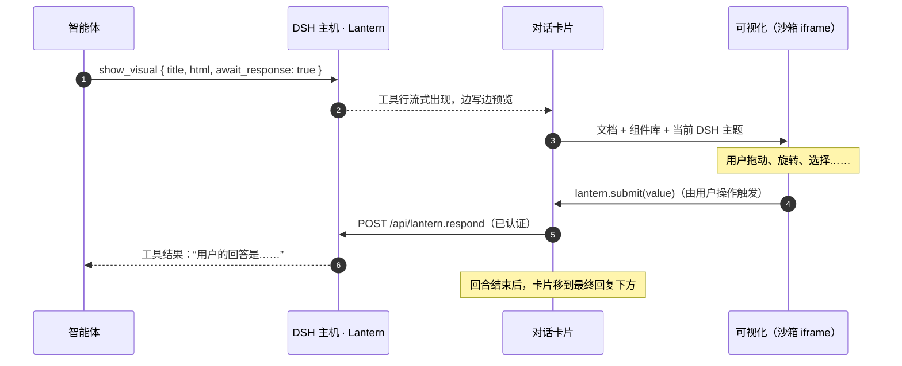

<p align="center">
  <picture>
    <source media="(prefers-color-scheme: dark)" srcset="docs/banner-zh-dark.svg">
    
  </picture>
</p>

<p align="center">
  <a href="README.md">English</a> · <a href="README.ja.md">日本語</a> · <b>简体中文</b>
</p>

<p align="center">
  
  
  
  
</p>

<p align="center">
  
</p>

**让智能体的回答不只是用来读，还能上手操作。** 只需一个工具 `show_visual`，就能把 HTML 变成 [DeepSeek Harness](https://github.com/deepseek-ai/deepseek-harness) Web 对话里的实时卡片：可以旋转的 3D 模型、可以动手试的模拟、可以刷选的图表、可以拖动排序的列表。当智能体用这种方式提问时，你的点击会直接作为答案返回给它。

## 有何不同

- 🪟 **留在对话里。** 卡片显示在回复下方，回合折叠后依然保留。已记录的答案可随对话恢复，可视化也能在同一浏览器中保存和恢复输入值。
- 🔁 **答案能回流。** 设置 `await_response: true` 后智能体会等待，用户的选择、排序或输入都作为工具结果返回。“继续追问”按钮则以用户身份发送消息。
- 🎨 **与 DSH 一致。** DSH 当前的主题（明/暗、颜色、字体）实时传入每个可视化，切换主题无需刷新。
- 🧰 **组件库只是起点。** 设计变量和组件通过 CSS 层叠层预先加载，可视化可以覆盖字体、颜色和布局。Three.js、D3、KaTeX、Chart.js 可从 `cdn.jsdelivr.net/npm/` 加载。
- 🗂️ **也能打开你的 HTML 文件。** 用 `path` 指向 DSH 主机本地工作区中的页面，即可在侧边栏中打开，并加载相对路径的 CSS、图片、模块和 JSON。
- 🪶 **无需加载技能，也能使用可视化。** 一段简短、可关闭的系统提示词会鼓励智能体在有帮助时使用可视化。工具说明包含基本用法，随附的 `lantern-visuals` 技能是可选的进阶指南。

## 示例库

以下每个都只是一次 `show_visual` 调用。点击图片可查看源码，截图会跟随你的 GitHub 主题切换。这些示例用于展示 Lantern 的表现力，实际效果取决于你使用的模型。

{{GALLERY}}

<table>
<tr>
<td width="50%"><br><sub>拖动概念图，再就某个节点向智能体提问。</sub></td>
<td width="50%"><br><sub>画几堵墙，看 A* 如何找到路。</sub></td>
</tr>
<tr>
<td colspan="2"><br><sub>拖动排序并确认，智能体会按你的顺序继续。</sub></td>
</tr>
</table>

## 快速开始

```sh
dsh plugin --profile web add github:Aero123421/dsh-lantern
# 然后重启 `dsh web`
```

支持 DSH `>=0.2.1-rc.2 <0.3.0-0` 的 Web 配置。本版本使用预发布版 DSH `0.2.1-rc.2` 进行了验证。也可以从 Release 的 `.tgz` 安装。用 `dsh --profile web --dump-config | grep lantern` 确认是否已加载。

然后直接提要求即可，例如：

- “咖啡因分子长什么样？给我一个能旋转的。”
- “用一个能动手玩的 3D 曲面讲解梯度下降。”
- “在一个可以画墙的网格上比较 A\* 和 Dijkstra。”
- “这是本迭代的工单，让我拖动排出优先级。”
- “在侧边栏打开 `report/index.html`。”

## 自动使用对话可视化

打开 **Plugins → dsh-lantern → 自动使用对话可视化**。默认开启，更改会自动保存，并在 DSH 为下一个模型执行步骤组装提示词时生效，无需重启或加载技能。

开启时，Lantern 会在系统提示词层注册 [102 个英文单词的简短指导](src/host/prompt.ts)。它鼓励用目的明确的小卡片解释、比较和探索，让控件在页面内即时响应，并仅在用户明确提交后把结果送回对话。简单回答仍可使用文字。这段指导不依赖 SKILLS 正文。实际 token 数取决于模型的分词器，工具说明也占用上下文。内置高级指南不会进入自动技能列表；如需阅读，可在消息开头显式输入 `/lantern-visuals`。

关闭此设置会移除这段指导，`show_visual` 仍可用于直接提出的可视化请求。在 Plugins 中禁用整个插件则会卸载其工具、路由、提示词部分和界面。使用工具不以读取可选设计指南为前提。

## 工作原理



## 面向模型：`show_visual` 工具

| 参数 | |
|---|---|
| `title` | 卡片和标签页标题（必填） |
| `html` | 片段或完整文档均可，组件库和主题已预先加载 |
| `path` | 用工作区的 `.html` 文件代替 `html`，总是在侧边栏打开 |
| `display` | `inline`（默认）或 `panel`（右侧边栏） |
| `await_response` | 等待用户回答并作为结果返回 |
| `replace` | 要修订的早先可视化的 `id`，旧卡片会折叠为指向新版本的链接 |

`html` 和 `path` 必须且只能提供其中一个。在可视化内部可以使用 `window.lantern`：`submit`、`send`、`setState` / `getState`、`expand`、`openLink`、`colors()`、`visible` 以及事件。常见操作无需脚本，用声明式属性即可：`data-lt-choices`、`data-lt-submit`、`data-lt-form`、`data-lt-send`、`data-lt-fullscreen`、标签页和步骤。可选的进阶指南（模式、3D、交互）见 [`skills/lantern-visuals`](skills/lantern-visuals/SKILL.md)。

<details>
<summary><b>外观随心定制：组件库只是起点</b></summary>

所有设计变量都可以覆盖，你自己写的样式永远优先于组件库：

```html
<link rel="stylesheet" href="https://fonts.googleapis.com/css2?family=Zen+Maru+Gothic:wght@500;700&display=swap">
<style>
  :root {
    --lt-font: "Zen Maru Gothic", var(--lt-font-sans);
    --lt-accent: #e8590c;
    --lt-radius: 18px;
  }
  :root[data-theme="dark"] { --lt-accent: #ff922b; }
</style>
<div class="lt-card raised lt-stack">
  <h3>外观由你，机制交给组件库</h3>
  <button class="primary" data-lt-submit='"ok"'>就这么定</button>
</div>
```

设计变量涵盖字体、字号、背景面、文字、边框、强调色、成功/警告/危险、8 种系列色、圆角、间距、阴影和动效。详见 [`references/kit.md`](skills/lantern-visuals/references/kit.md)。

</details>

## 工作区页面

`path: "report/index.html"` 会在侧边栏标签页中打开 DSH 主机本地工作目录里的真实文件。支持读取页面所在文件夹及其子文件夹中的相对路径样式、图片、模块脚本，以及通过 `fetch()` 加载数据。页面保留自己的外观，同时可以使用 `window.lantern` 和 `--lt-*` 主题变量；写上 `<meta name="lantern-kit">` 即可使用组件库。在模块中使用 `new URL('data.json', import.meta.url)` 定位数据文件。

工具运行时会记录原始目录和入口文件路径。即使会话的工作目录后来改变，重新打开卡片仍从原始目录读取文件。这是实时文件，不是快照：再次加载时会显示修改后的内容，已移动或删除的文件无法重新打开。不支持远程执行环境的文件系统，此时请改用嵌入数据的 `html`。Lantern `0.3.0` 之前创建、没有保存来源信息的旧 `path` 卡片需要重新创建。

如果工作区页面让自己的 iframe 跳转，或调用 `location.reload()`，Lantern 连接不会传递给新的文档。请先关闭其侧边栏标签页，再从对话中打开，或重新加载 DSH，以恢复连接和仍可用的已保存状态。


## 保存输入与答案

使用 `lantern.setState()` / `getState()`，可在可视化重新创建时恢复输入值。状态会尽可能保存在同一浏览器的 `localStorage` 中，最多保留 300 个可视化，不会在设备间同步。清除浏览器数据或存储容量限制可能使其丢失；存储不可用时，只能在当前页面内保留。

对于 `await_response: true`，主机在等待期间只接受一次答案。回答、关闭或取消后，后续提交会被拒绝，已接受的答案也会记录到对话中。没有待处理的等待时，包括超时之后，提交会成为新的用户消息。此类消息不保证在多个浏览器之间只发送一次。

## 安全

可视化是模型编写的代码，因此 Lantern 不信任它：

- **浏览器隔离。** 可视化运行在沙箱 iframe 中（`allow-scripts allow-forms allow-downloads`，不带 `allow-same-origin`）。不透明源可阻止对 DSH 的 DOM、Cookie 和浏览器存储的直接访问。卡片会校验桥接消息的发送方，并限制追问消息的频率和次数。
- **用户操作。** 回答、追问、外部链接和侧边栏请求，需要浏览器确认用户刚在该可视化内进行了操作。桥接使用每个文档独有的私有通道。但用户激活状态不能证明生成的控件标签真实准确，也不能证明提交的数据与显示内容一致。
- **限制资源加载。** CSP 位于可视化的代码之前。脚本和样式可从 `https://cdn.jsdelivr.net/npm/` 加载，也允许 Google Fonts 的样式和字体。HTML 可视化需要嵌入数据和图片：外部 `fetch`、XHR、WebSocket、图片和媒体均被阻止。嵌套框架、worker、object、表单提交和 `<base>` 也被阻止。流式预览还会过滤活动标记，并通过脚本 nonce 阻止模型脚本在预览期间运行。
- **工作区访问。** 文件页面还允许向其服务源发出资源请求，以支持相对路径素材和 `fetch()`。文件链接使用随机令牌，范围为页面所在文件夹及其子文件夹，8 小时后失效。链接由 DSH 的已认证 API 签发，持有链接即可访问其范围内的文件。符号链接会被解析，并在打开文件后再次校验；隐藏文件和文件夹一律拒绝。

这些措施不等于对任意 HTML 实现完全的网络隔离。允许的主机仍会收到请求，可视化也能让自己的 iframe 跳转到其他页面。工作区页面的 CSP 允许范围是其服务源，而不是某个文件夹。请勿把秘密信息放入可视化代码或共享页面所在的文件夹。

## 配置

自动使用可视化可通过 Plugins 中的开关控制，也可以在配置文件 `cordis.patch.yml` 中设置默认值：

```yaml
- id: dsh-lantern
  config:
    automaticVisuals: true     # 可选的系统指导；可在 Plugins 中实时更改
    answerTimeoutMinutes: 15   # 等待回答的时间（默认 15 分钟，最多 1440）
    maxHtmlChars: 400000       # html 参数上限（默认 400000 字符）
```

进阶设置：DSH 中标记为 `complete: true` 的提示词预设会替换整个系统提示词。Lantern 尊重这一设置，不会向完整预设追加指导。

## 开发

```sh
npm install
npm run check                                       # 类型检查、测试、构建（生成 lib/）
dsh plugin --profile web add /path/to/dsh-lantern   # 链接本地目录
```

`lib/` 已提交，所以从 GitHub 安装不需要构建。主机端是 Node ESM，运行时导入 `@deepseek-ai/schemastery` 来定义设置模式。浏览器端通过 DSH Web 的模块加载器加载，并共享 DSH 的 React 运行时。

## 路线图

- 用于 UI 检查的 GIF 与视频采集
- 渲染 MCP Apps 服务器提供的 UI
- 触屏上 3D 卡片的双指手势

## 许可证

MIT。Lantern 是非官方社区插件，与 DeepSeek 无关。
