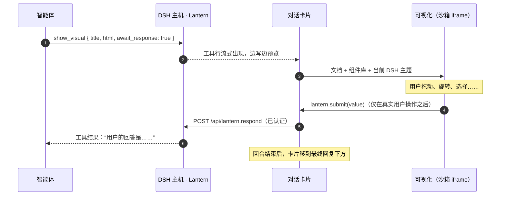

<p align="center">
  <picture>
    <source media="(prefers-color-scheme: dark)" srcset="docs/banner-zh-dark.svg">
    
  </picture>
</p>

<p align="center">
  <a href="README.md">English</a> · <a href="README.ja.md">日本語</a> · <b>简体中文</b>
</p>

<p align="center">
  
  
  
  
</p>

<p align="center">
  
</p>

**让智能体的回答不只是用来读，还能上手操作。** 只需一个工具 `show_visual`，就能把 HTML 变成 [DeepSeek Harness](https://github.com/deepseek-ai/deepseek-harness) Web 对话里的实时卡片：可以旋转的 3D 模型、可以动手试的模拟、可以刷选的图表、可以拖动排序的列表。当智能体用这种方式提问时，你的点击会直接作为答案返回给它。

## 有何不同

- 🪟 **留在对话里。** 卡片显示在回复下方，回合折叠后依然保留。刷新页面也会恢复，连答案和滑块位置都在。
- 🔁 **答案能回流。** 设置 `await_response: true` 后智能体会等待，用户的选择、排序或输入都作为工具结果返回。“继续追问”按钮则以用户身份发送消息。
- 🎨 **与 DSH 一致。** DSH 当前的主题（明/暗、颜色、字体）实时传入每个可视化，切换主题无需刷新。
- 🧰 **组件库只是起点。** 设计变量和组件通过 CSS 层叠层预先加载，可视化自己写的字体、颜色和布局永远优先。Three.js、D3、KaTeX、Chart.js 可直接从 CDN 加载。
- 🗂️ **也能打开你的 HTML 文件。** 用 `path` 指向工作区中的页面，即可在侧边栏中打开，相对路径的 CSS、图片、模块和 JSON 都能正常加载。凡是能打开 DSH Web 的地方都能用，包括 Cloudflare Tunnel 之后。
- 🪶 **不增加提示词负担。** 不向系统提示词添加任何内容。设计指南以技能（`lantern-visuals`）的形式提供，模型只在需要时读取。

## 示例库

以下每个都只是一次 `show_visual` 调用。点击图片可查看源码，截图会跟随你的 GitHub 主题切换。这些示例用于展示 Lantern 的表现力，实际效果取决于你使用的模型。

{{GALLERY}}

<table>
<tr>
<td width="50%"><br><sub>拖动概念图，再就某个节点向智能体提问。</sub></td>
<td width="50%"><br><sub>画几堵墙，看 A* 如何找到路。</sub></td>
</tr>
<tr>
<td colspan="2"><br><sub>拖动排序并确认，智能体会按你的顺序继续。</sub></td>
</tr>
</table>

## 快速开始

```sh
dsh plugin --profile web add github:Aero123421/dsh-lantern
# 然后重启 `dsh web`
```

需要 DSH 0.2.1 及以上（0.2.x）的 Web 配置。也可以从 Release 的 `.tgz` 安装。用 `dsh --profile web --dump-config | grep lantern` 确认是否已加载。

然后直接提要求即可，例如：

- “咖啡因分子长什么样？给我一个能旋转的。”
- “用一个能动手玩的 3D 曲面讲解梯度下降。”
- “在一个可以画墙的网格上比较 A\* 和 Dijkstra。”
- “这是本迭代的工单，让我拖动排出优先级。”
- “在侧边栏打开 `report/index.html`。”

## 工作原理



## 面向模型：`show_visual` 工具

| 参数 | |
|---|---|
| `title` | 卡片和标签页标题（必填） |
| `html` | 片段或完整文档均可，组件库和主题已预先加载 |
| `path` | 用工作区的 `.html` 文件代替 `html`，总是在侧边栏打开 |
| `display` | `inline`（默认）或 `panel`（右侧边栏） |
| `await_response` | 等待用户回答并作为结果返回 |
| `replace` | 要修订的早先可视化的 `id`，旧卡片会折叠为指向新版本的链接 |

在可视化内部可以使用 `window.lantern`：`submit`、`send`、`setState` / `getState`、`expand`、`openLink`、`colors()`、`visible` 以及事件。常见操作无需脚本，用声明式属性即可：`data-lt-choices`、`data-lt-submit`、`data-lt-form`、`data-lt-send`、`data-lt-fullscreen`、标签页和步骤。完整指南（模式、3D、交互）见 [`skills/lantern-visuals`](skills/lantern-visuals/SKILL.md)。

<details>
<summary><b>外观随心定制：组件库只是起点</b></summary>

所有设计变量都可以覆盖，你自己写的样式永远优先于组件库：

```html
<link rel="stylesheet" href="https://fonts.googleapis.com/css2?family=Zen+Maru+Gothic:wght@500;700&display=swap">
<style>
  :root {
    --lt-font: "Zen Maru Gothic", var(--lt-font-sans);
    --lt-accent: #e8590c;
    --lt-radius: 18px;
  }
  :root[data-theme="dark"] { --lt-accent: #ff922b; }
</style>
<div class="lt-card raised lt-stack">
  <h3>外观由你，机制交给组件库</h3>
  <button class="primary" data-lt-submit='"ok"'>就这么定</button>
</div>
```

设计变量涵盖字体、字号、背景面、文字、边框、强调色、成功/警告/危险、8 种系列色、圆角、间距、阴影和动效。详见 [`references/kit.md`](skills/lantern-visuals/references/kit.md)。

</details>

## 工作区页面

`path: "report/index.html"` 会在侧边栏标签页中打开工作目录里的真实文件。页面通过按文件夹限定、会过期的链接提供，因此相对路径的 `<link>`、``、`<script type="module">` 和 `fetch()` 都像在静态服务器上一样工作。页面保留自己的外观，同时可以使用 `window.lantern` 和 `--lt-*` 主题变量；写上 `<meta name="lantern-kit">` 即可使用组件库。


## 安全

可视化是模型编写的代码，因此 Lantern 不信任它：

- **隔离。** 可视化运行在沙箱 iframe 中（`allow-scripts allow-forms allow-downloads`，从不带 `allow-same-origin`）。它没有自己的源，无法访问 DSH 的 Cookie、DOM 或 API。唯一的出口是向卡片发送 `postMessage`，卡片还会校验发送方。
- **由用户决定。** 回答、消息、链接和侧边栏请求只在用户于该可视化内真实操作后才被接受。每个可视化只能回答一次；追问消息有间隔和次数限制。
- **挡得住的请求。** HTML 可视化拒绝对外的 `fetch`、XHR、WebSocket、图片、表单提交、`<base>` 和 `<script src>`。运行脚本后，卡片可以通过自身跳转，把已允许文件夹中的内容送出去。Chromium 没有实现 `navigate-to`。流式预览会去除脚本、事件属性、`javascript:` URL 和嵌入框架。
- **文件不越界。** 工作区链接是随机的，只覆盖页面所在文件夹，8 小时后失效，并且只能通过 DSH 的已认证 API 签发。符号链接会被解析，并在打开文件后再次校验；隐藏文件和文件夹一律拒绝。

## 配置

可选，写在配置的 `cordis.patch.yml` 中：

```yaml
- id: dsh-lantern
  config:
    answerTimeoutMinutes: 15   # 等待回答的时间（默认 15 分钟，最多 1440）
    maxHtmlChars: 400000       # html 参数上限（默认 400000 字符）
```

## 开发

```sh
npm install
npm run check                                       # 类型检查、测试、构建（生成 lib/）
dsh plugin --profile web add /path/to/dsh-lantern   # 链接本地目录
```

`lib/` 已提交，从 GitHub 安装无需构建。主机部分是 Node ESM；浏览器部分通过 DSH Web 的模块加载器加载并共享 DSH 的 React。运行时不导入任何 DSH 包。

## 路线图

- 用于 UI 检查的 GIF 与视频采集
- 渲染 MCP Apps 服务器提供的 UI
- 触屏上 3D 卡片的双指手势

## 许可证

MIT。Lantern 是非官方社区插件，与 DeepSeek 无关。
