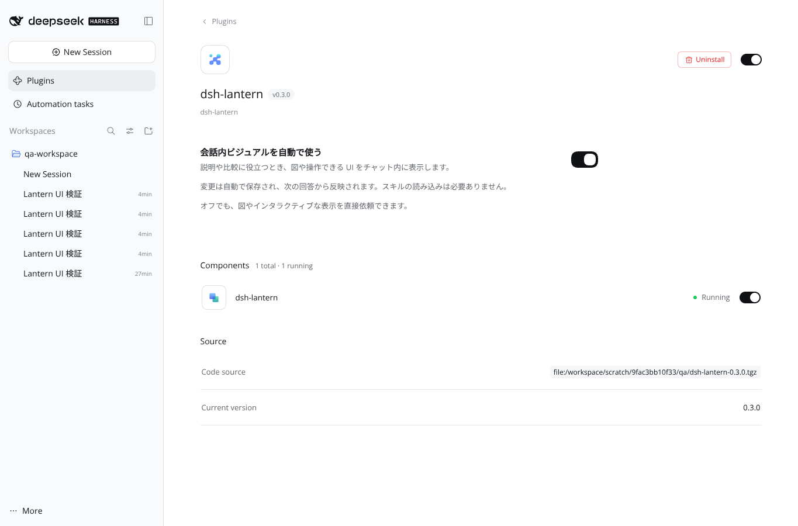
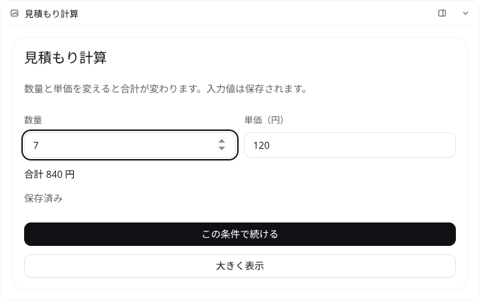
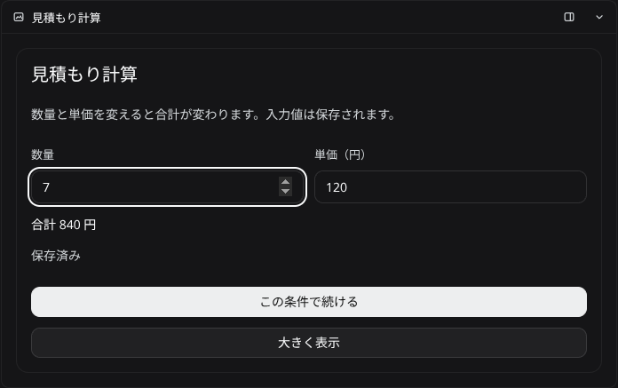
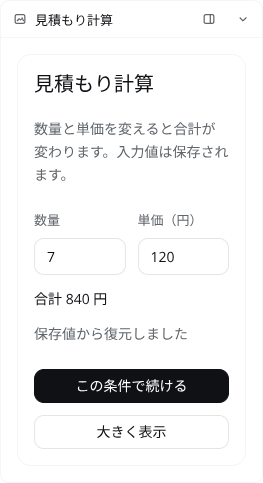

# dsh-lantern 監査メモ — 2026-10-19

## 1. 結論と対象

dsh-lantern v0.2.0 には、親画面の入力を借りた送信、CSP と説明の不一致、現在の DSH の会話末尾 API との不整合、過去のファイル表示の取り違えなど、実際の利用に影響する問題があった。本変更では、これらの修正と、Skills の読み込みを前提にしない短い system prompt ガイダンス、プラグイン設定画面の追加を行った。

本メモはコード上の根拠、再現結果、修正方針、検証の限界を記録する。DSH 全機能の安全性を保証するものではなく、Lantern が依存する本体機構と、実際にインストールした DSH Web を中心に調べたレビューである。

| 対象 | 比較・確認した版 |
|---|---|
| Lantern の比較元 | [43678ea9828dc9b89971c99b5f2e58aba7024362][lantern-baseline]、v0.2.0 |
| Lantern の修正対象 | このブランチの v0.3.0 候補。修正先への相対リンクは本メモを含むチェックアウトを指す |
| DSH 本体 | [687f282e8625c6b8d11ff58211a90524be2e4317][dsh-baseline]、0.2.1-rc.2 |
| 実行環境 | Linux、Node.js、DSH Web、Chromium |
| 自動テスト | 比較元 26 件成功。修正後 51 件成功、TypeScript 型検査成功 |

Lantern の公開履歴は次の 4 コミットを確認した。host の基本的な待機・ファイル解決処理は初回実装から引き継がれており、最新コミットで修正済みだった会話分離や storage fallback と、今回残っていた問題を分けて扱った。

| コミット | 主な内容 |
|---|---|
| [868112ea][commit-initial] | v0.1.0 の host / client / 待機 / ファイル配信 |
| [198e4467][commit-showcase] | v0.2.0、showcase、ビジュアル関連の修正 |
| [c69ef73a][commit-readme] | README、ギャラリー、多言語文書 |
| [43678ea9][lantern-baseline] | 会話分離、storage fallback、streaming preview |

レビュー対象には host API、待機応答、ワークスペース配信、iframe runtime、client の状態・履歴・会話末尾・テーマ、登録・設定 UI、manifest、build とテストを含む。DSH 側は system prompt / skill 注入、volatile 設定、connection の権限判定、session observation、plugin の登録解除と互換性判定を追った。

検証途中に既存プロファイルへ tgz を追加しただけでは、pnpm が以前の開発用リンクを残していた。配布物の試験前に remove → add を行い、インストール先がリポジトリへのリンクではない実体であることと、host / client の lib および package manifest のハッシュ一致を確認した。開発用リンクを使った初期の観測を、配布物の検証結果として扱わない。

## 2. 優先度付きの確定した Lantern の問題

優先度はこの機能への影響と修正の必要性に基づく。P1 は意図しない操作・誤った内容の表示・主要機能の不動作、P2 は特定の操作や条件での機能不良、P3 は表示の整合性に関する問題を表す。CVSS 評価ではない。

| ID | 優先度 | 問題 | 状態 |
|---|---|---|---|
| L-01 | P1 | 親画面の user activation を借り、iframe 内の入力なしで送信できる | 修正、実ブラウザで検証 |
| L-02 | P1 | CSP が任意の subresource 通信を制限せず、prelude の挿入位置も保証されない | 修正、通信と HTML 解析を実ブラウザで検証 |
| L-03 | P1 | 現在の DSH の turn-tail 契約と不一致。PTC の子ツールイベントも収集しない | 修正。PTC の実行環境には後述の制約 |
| L-04 | P1 | 同一セッションで作業ディレクトリを変えると、過去の path カードが別ファイルを表示する | 修正、再起動を含む回帰試験 |
| L-05 | P2 | awaited 回答の終端状態を区別できず、別の user message として重複送信する | 修正、host / client の回帰試験 |
| L-06 | P2 | unload と非同期 path 解決の競合で、closeAll 後に待機が生き返る | 修正、遅延を制御した再現試験 |
| L-07 | P2 | path ページの保存済み widget state を同期復元できない | 修正、runtime と実ブラウザで検証 |
| L-08 | P3 | 全カードを閉じている間のテーマ変更が次の表示へ反映されない | 修正、回帰試験 |
| L-09 | P2 | opaque な call ID を書き換え、path ページの識別・復元を壊す | 修正、長い ID・特殊文字・上限の回帰試験 |
| L-10 | P2 | iframe A から B へ直接移ると、B の正当なクリックを拒否する | 修正、A → B → A の実ブラウザ試験 |

### L-01 — 親画面の入力を借りた送信

**条件と影響。** ユーザーが DSH 本体のボタンを押した直後、iframe 側が自分へ focus を移し、メッセージを送ると、古い親側の guard は通過した。親の navigator.userActivation、activeElement、blur の時刻だけでは、入力がその iframe 内で起きたことを証明できない。iframe の生の window.postMessage も正規の runtime と同じ送信元になるため、送信元 window の確認だけでは区別できなかった。

元コードは [Frame.tsx の入力判定と focus 記録][old-activation]、[window message の受信][old-window-message]、[runtime の公開送信 API][old-runtime-actions]。独立した Chromium で、親のクリック → 子の window.focus() により旧 guard が true になることを再現した。

**修正。** [Frame.tsx](../src/client/Frame.tsx) と [runtime.ts](../src/frame/runtime.ts) で、モデルの script より前に文書ごとの nonce を使って private MessageChannel を接続する。通常の window message は接続にのみ使用し、操作は private port を通す。子の native userActivation getter を先に取得し、公開 API と送信直前の両方で確認する。親では focus、activation、状態、サイズ、頻度を検査する。

同一 JavaScript realm での prototype 改変も検証した。native MessagePort.postMessage と MessageEvent.data getter、Promise constructor / reject を事前に保持し、送信 envelope は own property を持つ object literal で作る。これにより、Object.prototype の setter、MessageEvent の getter からの currentTarget 取得、Promise executor の取り出し・再実行を介する迂回を防ぐ。serialized runtime の strict mode は build 後の両 lib にも残る。

**検証。** [runtime.test.ts](../test/runtime.test.ts) と実ブラウザで、親クリック後の直接送信と公開 API 経由の送信を拒否し、実際の子のクリックを許可した。prototype を改変した試験でも endpointExposed / envelopeExposed / executorExposed は false。これらは今回検証した経路の結果であり、任意のモデルコードに対する完全な隔離保証ではない。

### L-02 — CSP と trusted prelude の配置

**条件と影響。** 元の inline CSP は connect-src、form-action、base-uri しか制約せず、script・image・style 等の宛先を制限していなかった。workspace の prelude には subresource CSP 自体がなかった。「入力は visual 内にとどまる」とする説明は実装から保証できなかった。

さらに head タグを正規表現で探す挿入処理は、先行 script、属性値中の head、style の raw text 中の head などを正しく扱えない。CSP や runtime より先にモデルの script が動いたり、prelude が HTML の文字列・CSS の中へ入ったりする可能性があった。元コードは [document.ts の CSP と挿入処理][old-document]。

**修正。** [document.ts](../src/frame/document.ts) で、固定の doctype と trusted head を先頭に置く。default-src を none とし、通常の script / style / font の許可先、inline / data / blob、workspace の相対ファイルに必要な self を明示する。streaming preview の実行許可は trusted runtime の nonce に限定する。

**検証。** [document.test.ts](../test/document.test.ts) と Chromium で、CSP なしの対照ケースでは支配下の別ポートに script・image・fetch の 3 件が到達し、修正後の 4 ケースではそれぞれ到達 0 件となった。計 12 件の CSP 違反は期待した拒否である。元の lang、class、title、description、本文、独自 CSS、standards mode を保持し、予期しない pageerror はなかった。

**残る限界。** iframe 自身の location 変更は CSP で完全には止められず、実際に別ポートへ navigation の 1 件が到達した。許可した CDN もリクエストを受け取る。したがって「任意 HTML の通信を完全に遮断する」「入力情報が外へ出ない」とは説明しない。navigation / reload 後は以前の private bridge を引き継がず、カードを開き直す必要がある。

### L-03 — 会話末尾の API と PTC の子ツール

**条件と影響。** 元の Tail は props.turn.data.get(...) を呼んでいたが、確認対象の DSH が turn-tail slot に渡すのは TurnLocation である。古い読み方では現在の DSH の契約を満たさない。また収集対象が tool/call と tool/result だけなので、run_code 内から show_visual を呼ぶ PTC の tool/ptc-dispatch-start / tool/ptc-dispatch を拾えない。PTC の payload は turn を持たず、subCallId と親子関係で識別されるため、event.data.turn を流用する対応も不適切である。

根拠は [元の views.tsx の収集処理][old-definition] と [Tail][old-tail]、DSH の [slot の owner 定義][dsh-tail-contract]・[実際の受け渡し][dsh-tail-owner]・[PTC イベント契約][dsh-ptc]。

**修正。** 新しい [definition.ts](../src/client/definition.ts) は呼び出し単位の hidden Chat node を作り、DSH が解決した location をそのまま使う。[index.tsx](../src/client/index.tsx) で keyed hook を注入し、[views.tsx](../src/client/views.tsx) は現在の Chat target の turnDataSource を購読する。この方式は DSH の [ui-plan の実装][dsh-plan-hook] と同じ公開経路を使う。sidebar に必要な record がブラウザの履歴範囲にない場合は、[history.ts](../src/host/history.ts) の observation を使う取得 API から復元する。

**検証。** [definition.test.ts](../test/definition.test.ts) で native result、nested PTC、start が履歴範囲外の PTC settlement、DSH 由来の location の保持を確認した。[host.test.ts](../test/host.test.ts) は PTC の保存済み metadata の復元も含む。実際の PTC run_code は検証ホストの sandbox-unavailable に阻まれており、fixture / event replay の成功を実 PTC 実行の成功とは扱わない。

### L-04 — 過去の path と作業ディレクトリの取り違え

**条件と影響。** 同じセッションでディレクトリ A の page.html を表示し、次に B の同名ファイルを表示してから A の古いカードを開き直すと、B の内容が返った。元の host は cwd をセッション単位で上書きし、ファイル API は sessionId と相対 path しか受け取らなかった。独立した再現では HTTP 200 のまま「A は含まれない、B が含まれる」となり、エラーより見つけにくい誤表示だった。

根拠は [cwdBySession と復元用 fallback][old-source-cache]、[tool 実行と lantern.file][old-source-route]。

**修正。** [host/index.ts](../src/host/index.ts) と [history.ts](../src/host/history.ts) で、呼び出し時に解決した source の kind、canonical root、相対 entry を結果 metadata に固定する。API は sessionId / callId だけで、その呼び出しの source を取得する。クライアントが任意の root を再指定する形にはしない。awaited path の解決中は同じ Promise を共有するため、tool result がまだなくてもファイルを開ける。

Node host と DSH の実行環境で同じ path が同じファイルとは限らない。DSH の [filesystem mapping 契約][dsh-fs] に従って host-local の同一性を確認し、remote / mapping 不明の場合は path を拒否して html を案内する。ディレクトリ取得の cancellation を別の cwd に置き換えない。

**検証と互換性。** [host.test.ts](../test/host.test.ts) に A / B の同名ファイル、host 再起動後、awaited 実行中の表示、remote 拒否、cancellation の回帰を追加した。source のない旧カードは推測で別ディレクトリを開かず、再作成を求める。固定するのは元の場所であり、HTML の内容自体の snapshot ではない。同じ場所のファイルが更新されれば、その新しい内容を読む。

### L-05 — awaited 回答の重複・終端状態の混同

**条件と影響。** 二つのブラウザが同じ awaited visual に答えると、最初の回答で waiter が消える。元の host が二つ目に返す not-waiting は、回答済み・dismiss 済み・終了・timeout を区別しない。クライアントは settled 以外を通常の user message に変えるため、回答済みの選択が新たな発言として送られ得た。結果 metadata を受信済みの場合にも、元の条件分岐は host 確認を飛ばしていた。

根拠は [元の pending.ts の settle][old-pending-status] と [services.ts の fallback][old-answer]。

**修正。** [pending.ts](../src/host/pending.ts) は answered / dismissed / closed / timeout の終端を保持し、unknown と分ける。[history.ts](../src/host/history.ts) は再起動後の保存済み終端を参照する。[services.ts](../src/client/services.ts) は awaited call で host に確認し、明示的な timeout の場合だけ遅い回答を user message にする。同じ origin の別タブでは Web Locks で送信処理を直列化し、ロック取得後に storage を読み直す。[store.ts](../src/client/store.ts) は他タブの storage 更新を反映する。

**検証と限界。** [host.test.ts](../test/host.test.ts)、[services.test.ts](../test/services.test.ts)、[store.test.ts](../test/store.test.ts)、[runtime.test.ts](../test/runtime.test.ts) で終端の区別、二重回答、タブ間の再確認、確定済み選択肢のロックを確認した。non-awaited visual と timeout 後の user message は、別端末まで含むサーバー側の一度だけの配送を保証する設計ではない。Web Locks がない環境の fallback はページ内の重複抑止になる。

### L-06 — closeAll 後に待機が生き返る競合

**条件と影響。** awaited path の作業ディレクトリ取得を遅らせ、解決前に plugin を unload する。元の closeAll はその時点の waiter だけを閉じるため、その後 path 解決が完了すると新しい wait が登録される。独立再現では timeout を 120 ms に短縮しても closed ではなく timeout となった。既定では 15 分の待ちになり得る。

根拠は [host の dispose][old-source-cache] と [非同期実行][old-source-route]、[pending.ts の wait / closeAll][old-pending-wait]。

**修正と検証。** [pending.ts](../src/host/pending.ts) に閉鎖後を表す終端フラグを持たせ、closeAll 後の wait は即 closed とする。[pending.test.ts](../test/pending.test.ts) と [host.test.ts](../test/host.test.ts) で closeAll 後の登録と、遅延した path 解決との組み合わせを検証した。

### L-07 — path ページの同期 state 復元がない

**条件と影響。** path ページで lantern.setState() に保存しても、再表示時にファイルサーバーが与える widgetState は常に null だった。inline と違い、path の src 生成はブラウザの保存値を渡さず、ready 後にも widgetState を戻す経路がなかった。ページ起動時の getState() を使う UI は毎回初期化された。

根拠は [元の files.ts の boot][old-file-boot]、[Frame.tsx の inline / path の違い][old-frame-boot]、[runtime の state 初期化][old-runtime-boot]。

**修正。** [Frame.tsx](../src/client/Frame.tsx) は path 用 iframe の一時的な name に、呼び出し ID、文書 nonce、表示状態、回答、widget state を渡す。[runtime.ts](../src/frame/runtime.ts) の trusted prelude がモデルの script より先に ID とサイズを確認し、同期復元して name を消す。ブラウザの state を URL の query へ入れない。

**検証。** [runtime.test.ts](../test/runtime.test.ts) で ready の往復前に state が読み出せること、他の call ID、壊れた JSON、サイズ超過を受け入れず name を消すことを確認した。実ブラウザでも state / response / widget をモデルの最初の script で読み、name が空、boot 要素が除去済み、親 DOM を読めないことを確認した。

### L-08 — 表示がない間のテーマ変更を取りこぼす

**条件と影響。** 全 visual を閉じると observer は外れるが、元の theme cache は残る。その間に DSH の light / dark を変更して再表示すると、古い snapshot を返し、再購読時にも初回の再読み取りがなかった。

根拠は [元の theme.ts][old-theme]。修正した [theme.ts](../src/client/theme.ts) は購読者がいないときの取得で実際のテーマを読み、最初の購読開始時にも refresh する。[theme.test.ts](../test/theme.test.ts) で unmount → テーマ変更 → 再表示と、render から effect までの間の変更を確認した。

### L-09 — opaque call ID の破壊

**条件と影響。** 元の files.ts は query の call ID から英数字等以外を削除し、128 文字で切っていた。host 側 API の上限は 200 文字であり、呼び出し ID は opaque なので、この変換に意味上の根拠はない。長い ID や slash・非 ASCII を含む ID は lantern.id が元と一致しなくなる。今回追加した ID を照合する path 復元・nonce 接続では、この不一致が接続不能の原因にもなるため、修正途中の相互作用としても確認した。

根拠は [元の files.ts][old-file-boot]。修正した [files.ts](../src/host/files.ts) は 200 文字以内の ID をそのまま使い、scriptJson で HTML 内への埋め込みを保護する。上限超過は 400 とする。[files.test.ts](../test/files.test.ts) では 140 文字超に slash・日本語・script 終了文字列を含む ID が完全一致で復元され、201 文字は拒否されることを確認した。現在の一般的な PTC ID がこの問題を起こしていた、という主張ではない。

### L-10 — 複数カードの focus 遷移を誤拒否する

**条件と影響。** 親画面をクリックせず、iframe A のボタンから B のボタンへ直接移る。親 window は A へ移った時しか blur しないため、B の focusedAt は 0 のままになる。元の guard では、子の実 activation が true でも B を拒否した。

根拠は [元の Frame.tsx の blur 依存][old-activation]。Chromium の再現では親 blur は A の 1 回だけで、A → B → A の旧 guard の結果は true / false / true だった。

**修正と検証。** [Frame.tsx](../src/client/Frame.tsx) から親の lastHostInput / focusedAt / blur listener を削除した。private runtime の native child activation と、親の activeElement / activation、頻度・状態・lifecycle 検査は維持する。修正後は B の focusedAt を 0 と観測したまま、実際の A → B → A をすべて受理した。同じ試験で親クリックを借りた送信と prototype 攻撃を拒否しており、誤拒否を直すために private child の検査を弱めてはいない。

## 3. Skills なしで使うための追加機能

[host/prompt.ts](../src/host/prompt.ts) に、automaticVisuals の volatile 設定と systemPrompt.section() を追加した。既定はオンで、[Settings.tsx](../src/client/Settings.tsx) をプラグインの設定欄へ登録する。変更は DSH の ConfigForms / revision 付き mutation を経由する。

追加する本文は英語 102 語・668 文字である。目的は、説明・比較・探索・選択に役立つ場合に show_visual を自然に選ばせること。主要な回答と出典は文章にも残し、操作による探索はカード内で処理し、必要なときだけユーザーの送信や await を使い、入力状態を保存する方針を短く示す。細かい API は [tool description](../src/host/description.ts) に置き、[上級 skill](../skills/lantern-visuals/SKILL.md) は任意の補助資料として残す。

実リクエストの確認では、DSH 標準の skill カタログが「該当する skill を先に読む」とモデルへ案内していた。そこで bundled guide の invocation を modelInvocable:false / userInvocable:true とし、通常のモデル用カタログから除外した。ユーザーが `/lantern-visuals` を明示した場合の読み込みは残す。これは [DSH のカタログフィルター](https://github.com/deepseek-ai/deepseek-harness/blob/687f282e8625c6b8d11ff58211a90524be2e4317/packages/skill/tool-skill/src/index.ts#L222-L229) と [明示呼び出し経路][dsh-skill-invocation] に従う。他の skill や、同名のユーザー定義 skill の policy は変更しない。

自動利用のスイッチをオフにすると、このガイダンスは空になる。show_visual 自体は利用可能なので、明示的に依頼された visual は作れる。プラグインそのものを無効にしたときは、tool・prompt・UI の登録も lifecycle に従って外れる。

これは ChatGPT の非公開 UI ランタイムを移植したものではない。DSH の既存 tool / iframe / Chat node を使い、短い system prompt で適切な場面の選択を促す実装である。実 LLM の選択品質については第 6 節の限界がある。

## 4. DSH 本体との接続で確認した仕様

| 接続点 | 確認結果と Lantern 側の扱い |
|---|---|
| system prompt の位置 | section は system prompt の組み立てに入る。order 10110 は Web surface 後の並び順であり、それ自体が新しい権限階層を作る値ではない |
| Skills との関係 | skill tool の本文は tool 結果、明示的 skill は user message の注入として入る。Lantern の短いガイダンスはその前提資料の読み込みを必要としない |
| complete prompt | complete: true があれば、その section が最終 system prompt を置き換える。Lantern はこの設定を尊重する |
| 反映時点 | prompt は次の preStep で組み立て直す。同じ step の再試行は既に組み立てた system prompt を使用する |
| volatile | active fiber の volatile-only 更新は値の参照を更新する。Lantern は boolean と volatile getter の両方を扱う |
| 設定 UI の owner | custom page の auto:false は Lantern の fiber を owner に指定し、DSH の設定サービスで保存する |
| API の権限 | connection の exact Fetch route は owner principal のみ。Lantern の respond 等を無認証 API とする指摘は成立しない |
| ブラウザからの API | Host fence、cross-site 拒否、Origin:null 拒否がある。opaque iframe が DSH API を直接読む経路とは分ける |
| 保存済み会話 | observeSession() の immutable cut を読み、finally で lease を dispose。新しい直接 snapshotEvents() 呼び出しは加えていない |
| path の実行環境 | host path と実行環境の path の同一性は自明ではない。Lantern は local の mapping を確認する |
| 互換性 | engines.dsh がある場合は、その値が DSH の互換性判定で優先される。今回検証した rc.2 以上を明示する |
| 登録解除 | route / prompt / tool / slot は owner の effect に紐付く。待機と source cache の終了処理も加えた |

一次根拠：

- [system prompt の順序と組み立て][dsh-prompt]、[complete の適用][dsh-complete]、[preStep][dsh-pre-step]、[step 内の prompt 再利用][dsh-step]。
- [skill tool の render][dsh-skill-render]、[明示 skill の user message 注入][dsh-skill-invocation]。
- [Loader の volatile 更新][dsh-volatile]、[Settings の custom page 設定][dsh-settings]。
- [exact route の owner 判定と effect][dsh-route]、[API request trust][dsh-trust]。
- [SessionObservation 契約][dsh-observation]、[prepared lease の解放][dsh-observation-dispose]。
- [filesystem mapping][dsh-fs]、[local filesystem の実装][dsh-fs-local]、[engine 判定][dsh-compatibility]。

## 5. DSH 設定保存の writer lock — 実症状と未確定の原因

**実症状を確認したが、原因となる fiber は未特定である。** 開発用リンクを使った Web プロファイルで設定のオン・オフとブラウザの再読み込みを続けた後、後続の設定保存が次のエラーで拒否された。

> settings/rejected: atomic-write: timed out waiting for the writer lock at …/profiles/web/package.json.lock

ロックを読み取ると、その時点の稼働中 DSH の PID 18213 を記録しており、以前の終了済み PID の残骸ではなかった。複数回の stat で数分以上の保持を確認した。cordis.patch.yml は lock 作成の約 80 ms 後に更新されていた。発症時点で chat / tool の呼び出しはまだなく、lib の build もその間には行っていなかった。並行して linked plugin 配下の src / test / 文書の編集はあったが、それを原因と断定する根拠はない。

ソースから確定できる処理は次の通りである。

1. [ConfigEditor][dsh-config-editor] は共通の package.json writer lock を取得したまま、設定ファイルの書き込みと profile reconciliation を待つ。
2. [app-boot の recompose][dsh-recompose] は previous fibers と Loader の完了を待つ。
3. [atomic-write][dsh-lock] は囲んだ operation の完了後に finally で lock を外す。後続の取得待ちは既定で 2 秒であり、記録された PID が生きていれば自動的に奪わない。

したがって設定保存後の reconciliation 待ちが関係する可能性はあるが、プロセスの停止箇所を直接特定したものではない。「stale lock」「atomic-write 自体の欠陥」「linked watcher のデッドロック」という原因名は、今回の証拠では確定できない。

切り分けとして、インストール済み rc.2 の実際の ConfigEditor・Settings・Lantern を一時プロファイルで起動した。通常構成で 8 回の設定切替が成功した。実 HMR を加えた構成でも、4 回切替 → watcher の自動反映を待つ → 4 回切替が成功し、各応答後の Loader pending は 0、lock はなかった。host / HMR の dispose も完了した。基本的な volatile 更新だけで必ず発症する、という結果ではない。

稼働中の lock は手動削除せず、DSH の正常終了後に配布物を remove → add で入れ直した。開発リンクが残っていないことを確認した配布版の再検証では、連続した設定切替で lock は再発しなかった。本体コードの原因修正を行ったわけではなく、開発中の特定条件で観測した未解決事項として残す。

## 6. 検証の証拠と限界

### 自動テストと独立したブラウザ試験

比較元では 26 件、修正後は 51 件のテストが成功した。新規・拡張テストは、[host](../test/host.test.ts)、[pending](../test/pending.test.ts)、[services](../test/services.test.ts)、[store](../test/store.test.ts)、[definition](../test/definition.test.ts)、[runtime](../test/runtime.test.ts)、[document](../test/document.test.ts)、[files](../test/files.test.ts)、[theme](../test/theme.test.ts) にある。TypeScript 型検査も成功した。

独立した Chromium の試験では、Web security と origin checks を有効にし、親 DOM の隔離、private bridge、prototype 改変、親から借りた activation の拒否、複数 iframe 間の実クリック、同期 state 復元を確認した。CSP の実ネットワーク試験では、支配下の別ポートへ届く要求と拒否される要求を区別し、自己 navigation は実際に到達する限界として記録した。Node の VM による runtime テストだけをブラウザ隔離の証明には使っていない。

### PTC の実行環境

実 DSH の run_code から PTC visual を作る試験は、ホスト側で次のエラーとなった。

> code run failed (sandbox-unavailable): sandbox mode "workspace-write" is requested but no sandbox backend is usable on this host

これは Lantern が子ツールを処理する前の実行環境の失敗である。要求された sandbox を外した成功扱いの試験は行っていない。イベント fixture による nested PTC と履歴復元の検証と、実際の sandbox 内で run_code → show_visual を実行する全体試験は区別する。後者はこの環境では未完了である。

### 実 CDN とライブラリ

KaTeX 0.16.11 と three.js 0.170.0 の実 jsDelivr URL は、ブラウザで net::ERR_CERT_AUTHORITY_INVALID により取得できなかった。このとき CSP 違反はなかった。証明書検証を無効にして成功とはしていない。

同一 URL を route mock で最小 script / ES module に置き換えるとロードでき、CSP の許可先の判定は確認できた。これは実 CDN の通信成功や、実 KaTeX / three.js の全体動作を確認した結果ではない。

### 実 LLM の選択品質

モデルの応答を固定した検証用 API は、DSH へ渡る prompt、tool 呼び出し、UI、状態、回答経路を再現可能に調べるために使った。実 LLM が常に適切な場面でカードを選ぶか、説明・データ・操作性を十分な品質で作れるか、GPT-6 / ChatGPT と同等の体験になるかは検証していない。システムプロンプトの存在と、モデルによる利用品質は別の評価対象である。

### 残る仕様上の制約

- path は DSH host の local filesystem を対象とする。remote workspace は html を使う。
- source は元の場所を固定する。ファイル内容の永続 snapshot ではなく、旧結果に source がなければ再作成を求める。
- ファイル URL はページのフォルダと配下を対象とする期限付き bearer link である。URL を知る相手はその範囲を読めるため、すべてのファイル取得が owner API を再通過するという説明にはしない。
- widget state はそのブラウザの storage に依存する。別端末との同期や storage 消去後の復元は提供していない。
- iframe の subresource CSP と opaque origin は、任意の JavaScript や全通信を完全に封じる環境ではない。許可 CDN と自己 navigation の限界がある。
- private child activation は iframe 内の最近の入力を確認する。送信する文章の意味までユーザーが承認したことを技術的に保証するものではない。
- non-awaited / timeout 後の user message には、別端末を含む厳密な一度だけの配送保証はない。
- DSH の全 provider・全ツール・全共有モード、Windows / macOS、実 remote filesystem の全経路を監査したものではない。

## 7. 実 DSH に配布パッケージを入れた確認

DSH 0.2.1-rc.2 を専用プロファイルで起動し、Linux 上の Chromium 153.0.8010.0 から操作した。ブラウザの Web security と origin checks は有効である。モデル接続先は loopback の固定 Messages API とし、認証には検証専用の値だけを使った。実モデルの判断や表現品質を計測する試験ではない。

### 通常のカード・設定・回答

| 操作 | 実際に確認した結果 |
|---|---|
| 配布物の導入 | npm pack した tgz を DSH plugin コマンドで導入。開発用リンクを除去し、実体の package.json / host lib / client lib がチェックアウトと一致 |
| プラグイン設定 | 複数回のオン・オフ保存、ブラウザ再読み込み後の値の保持、チャット利用後の連続保存に成功。最後の writer lock はなし |
| システム指示 | オフの新規セッションでは追加ガイダンスなし・show_visual は公開。オンの新規セッションでは実際の system にガイダンスあり |
| スキルなしの通常利用 | 最終 tgz で再試験し、オン・オフとも新規セッションの自動カタログに Lantern ガイドがないこと、通常カードのリクエストにガイド本文がないことを確認 |
| 明示的なガイド利用 | 別の新規セッションで `/lantern-visuals` を送ると、そのリクエストにだけガイド本文が注入されることを確認 |
| 通常カード | 固定の show_visual 呼び出しが実 DSH の tool pipeline を通り、ターン終了後も回答の下に残る |
| 入力保存 | 数量を 7、単価を 120 にして合計 840。DSH 全体を再読み込みしても 7 と 840 を復元 |
| キーボード | カードの送信ボタンを Enter で実行し、実際に次の会話へ届く |
| 回答待ち | await_response の選択が HTTP 200 / status:settled で確定し、ツール結果からモデル処理が再開 |
| 二つのタブ | 一方で B を選ぶと、もう一方も B の確定状態になり、選択肢を無効化。再読み込み後も維持 |
| ワークスペース | 相対 CSS、ES module、JSON、SVG の読み込みに成功。JSON の 3 / 8 / 5 と、独自 h1 色 rgb(39,137,111) を確認 |
| HTML の保持 | path ページの lang=ja、元の class、title、画像を保持。一時 window.name はモデルのコード開始前に空になる |
| path の state | 入力 11 を保存し、ページの初期 inline script が同期 getState() で「復元:11」を表示。その後の送信も会話へ届く |
| 日本語 | 日本語ブラウザでは Lantern のプラグイン設定と操作文言が日本語になる |
| テーマ | 表示中に OS の dark preference を変えるとカードも dark。Plugins へ移動してカードのない間に light へ戻し、チャットへ復帰すると light と入力 7 を復元 |
| 狭い画面 | 390 px の viewport でカードの clientWidth / scrollWidth はともに 261 px。対象 fixture に横方向のあふれなし |
| 動きの設定 | prefers-reduced-motion:reduce が iframe にも伝わる |

未捕捉の JavaScript pageerror はなかった。通常の全体試験では `/open-in-app/icon/vscode` が 404 を 8 回返した。これは DSH の外部アプリ用アイコンの取得で、Lantern の API や素材の失敗ではない。DSH の [ApplicationIcon](https://github.com/deepseek-ai/deepseek-harness/blob/687f282e8625c6b8d11ff58211a90524be2e4317/packages/client/ui-open-in-app/src/client/OpenTargetButton.tsx#L74-L80) には読み込み失敗時の代替アイコンがある。ブラウザコンソールのエラーが完全に 0 だったという報告にはしない。

上級ガイドを明示専用にする最終変更の後にも、クリーンな npm ci から npm run check を実行し 51 件すべて成功した。最終 tgz を入れ直した focused E2E では、設定の保存・再読み込み、オン／オフの system prompt、通常のカード表示・入力復元、ガイドの自動カタログ除外と明示呼び出しを再確認した。この試験の 404 は同じ VS Code アイコンの 4 回で、pageerror はなかった。

### 実画面

以下は実 DSH に表示した固定 fixture のスクリーンショットである。モデルが自発的に作った出力例としては扱わない。日本語フォントのない検証環境には Noto Sans CJK JP を追加して撮影した。



| ライト | ダーク |
|---|---|
|  |  |



## 8. 候補ブランチの確認方法

この版は DSH `>=0.2.1-rc.2 <0.3.0-0` の Web プロファイルを対象とする。既存の DSH で候補ブランチを確認する場合は、次の指定を使い、DSH Web を再起動する。

```sh
dsh plugin --profile web add 'github:Aero123421/dsh-lantern#codex/lantern-natural-interactive-ui'
dsh web
```

Plugins → dsh-lantern → 「会話内ビジュアルを自動で使う」で切り替える。既定はオン。通常利用に skill 読み込みは必要ない。上級ガイドを明示的に読みたい場合だけ `/lantern-visuals` でメッセージを始める。

開発用のローカルリンクから tgz や GitHub 版へ切り替える場合は、インストール先の実体を確認する。今回の試験では add だけでは古いリンクが残ったため、停止した検証プロファイルで remove → add を行った。単に package.json の dependency 表記が変わったことだけを配布物の導入確認には使わない。

最終の確認用 tgz は 0.3.0、14 ファイルで、npm pack が返した SHA-1 は `458be0838fe1bad5131eb575766668dc9fa990ed`。この作業は候補ブランチの作成であり、npm や GitHub Release の公開ではない。コードから確認する場合は `npm ci`、`npm run check` で型検査・51 件の回帰試験・lib の再生成を行える。

[lantern-baseline]: https://github.com/Aero123421/dsh-lantern/tree/43678ea9828dc9b89971c99b5f2e58aba7024362
[commit-initial]: https://github.com/Aero123421/dsh-lantern/commit/868112ea8512a5f93b1a64848d7bf2a1cf096280
[commit-showcase]: https://github.com/Aero123421/dsh-lantern/commit/198e44672dfe01b1433acea0a0532faa627c6796
[commit-readme]: https://github.com/Aero123421/dsh-lantern/commit/c69ef73ab1dac4fd8ad83db15778adc897d61793
[dsh-baseline]: https://github.com/deepseek-ai/deepseek-harness/tree/687f282e8625c6b8d11ff58211a90524be2e4317
[old-activation]: https://github.com/Aero123421/dsh-lantern/blob/43678ea9828dc9b89971c99b5f2e58aba7024362/src/client/Frame.tsx#L45-L90
[old-window-message]: https://github.com/Aero123421/dsh-lantern/blob/43678ea9828dc9b89971c99b5f2e58aba7024362/src/client/Frame.tsx#L118-L170
[old-runtime-actions]: https://github.com/Aero123421/dsh-lantern/blob/43678ea9828dc9b89971c99b5f2e58aba7024362/src/frame/runtime.ts#L116-L135
[old-runtime-boot]: https://github.com/Aero123421/dsh-lantern/blob/43678ea9828dc9b89971c99b5f2e58aba7024362/src/frame/runtime.ts#L56-L64
[old-frame-boot]: https://github.com/Aero123421/dsh-lantern/blob/43678ea9828dc9b89971c99b5f2e58aba7024362/src/client/Frame.tsx#L92-L119
[old-document]: https://github.com/Aero123421/dsh-lantern/blob/43678ea9828dc9b89971c99b5f2e58aba7024362/src/frame/document.ts#L31-L108
[old-definition]: https://github.com/Aero123421/dsh-lantern/blob/43678ea9828dc9b89971c99b5f2e58aba7024362/src/client/views.tsx#L42-L82
[old-tail]: https://github.com/Aero123421/dsh-lantern/blob/43678ea9828dc9b89971c99b5f2e58aba7024362/src/client/views.tsx#L178-L204
[old-source-cache]: https://github.com/Aero123421/dsh-lantern/blob/43678ea9828dc9b89971c99b5f2e58aba7024362/src/host/index.ts#L84-L103
[old-source-route]: https://github.com/Aero123421/dsh-lantern/blob/43678ea9828dc9b89971c99b5f2e58aba7024362/src/host/index.ts#L136-L198
[old-pending-status]: https://github.com/Aero123421/dsh-lantern/blob/43678ea9828dc9b89971c99b5f2e58aba7024362/src/host/pending.ts#L43-L62
[old-pending-wait]: https://github.com/Aero123421/dsh-lantern/blob/43678ea9828dc9b89971c99b5f2e58aba7024362/src/host/pending.ts#L17-L62
[old-answer]: https://github.com/Aero123421/dsh-lantern/blob/43678ea9828dc9b89971c99b5f2e58aba7024362/src/client/services.ts#L77-L112
[old-file-boot]: https://github.com/Aero123421/dsh-lantern/blob/43678ea9828dc9b89971c99b5f2e58aba7024362/src/host/files.ts#L118-L130
[old-theme]: https://github.com/Aero123421/dsh-lantern/blob/43678ea9828dc9b89971c99b5f2e58aba7024362/src/client/theme.ts#L128-L150
[dsh-tail-contract]: https://github.com/deepseek-ai/deepseek-harness/blob/687f282e8625c6b8d11ff58211a90524be2e4317/packages/client/ui-chat/src/client/contract/slots.ts#L55-L60
[dsh-tail-owner]: https://github.com/deepseek-ai/deepseek-harness/blob/687f282e8625c6b8d11ff58211a90524be2e4317/packages/client/ui-chat/src/client/chat/TurnTailNodeView.tsx#L43-L49
[dsh-ptc]: https://github.com/deepseek-ai/deepseek-harness/blob/687f282e8625c6b8d11ff58211a90524be2e4317/packages/core/tools/src/types.ts#L12-L61
[dsh-plan-hook]: https://github.com/deepseek-ai/deepseek-harness/blob/687f282e8625c6b8d11ff58211a90524be2e4317/packages/client/ui-plan/src/client/index.ts#L79-L96
[dsh-prompt]: https://github.com/deepseek-ai/deepseek-harness/blob/687f282e8625c6b8d11ff58211a90524be2e4317/packages/core/system-prompt/src/index.ts#L131-L165
[dsh-complete]: https://github.com/deepseek-ai/deepseek-harness/blob/687f282e8625c6b8d11ff58211a90524be2e4317/packages/core/system-prompt/src/index.ts#L614-L686
[dsh-pre-step]: https://github.com/deepseek-ai/deepseek-harness/blob/687f282e8625c6b8d11ff58211a90524be2e4317/packages/core/agent-loop/src/agent.ts#L267-L278
[dsh-step]: https://github.com/deepseek-ai/deepseek-harness/blob/687f282e8625c6b8d11ff58211a90524be2e4317/packages/core/agent-loop/src/agent.ts#L400-L423
[dsh-skill-render]: https://github.com/deepseek-ai/deepseek-harness/blob/687f282e8625c6b8d11ff58211a90524be2e4317/packages/skill/tool-skill/src/index.ts#L126-L127
[dsh-skill-invocation]: https://github.com/deepseek-ai/deepseek-harness/blob/687f282e8625c6b8d11ff58211a90524be2e4317/packages/skill/tool-skill/src/index.ts#L165-L205
[dsh-volatile]: https://github.com/deepseek-ai/deepseek-harness/blob/687f282e8625c6b8d11ff58211a90524be2e4317/vendor/loader/src/config/entry.ts#L141-L195
[dsh-settings]: https://github.com/deepseek-ai/deepseek-harness/blob/687f282e8625c6b8d11ff58211a90524be2e4317/packages/settings/settings/src/index.ts#L266-L276
[dsh-route]: https://github.com/deepseek-ai/deepseek-harness/blob/687f282e8625c6b8d11ff58211a90524be2e4317/packages/client/connection/src/rpc-host.ts#L207-L250
[dsh-trust]: https://github.com/deepseek-ai/deepseek-harness/blob/687f282e8625c6b8d11ff58211a90524be2e4317/packages/client/connection/src/api-request-trust.ts#L121-L175
[dsh-observation]: https://github.com/deepseek-ai/deepseek-harness/blob/687f282e8625c6b8d11ff58211a90524be2e4317/packages/session-query/session-query/src/observation.ts#L16-L40
[dsh-observation-dispose]: https://github.com/deepseek-ai/deepseek-harness/blob/687f282e8625c6b8d11ff58211a90524be2e4317/packages/session-query/session-query/src/observation.ts#L245-L271
[dsh-fs]: https://github.com/deepseek-ai/deepseek-harness/blob/687f282e8625c6b8d11ff58211a90524be2e4317/packages/fs/fs/src/index.ts#L144-L155
[dsh-fs-local]: https://github.com/deepseek-ai/deepseek-harness/blob/687f282e8625c6b8d11ff58211a90524be2e4317/packages/fs/fs-local/src/index.ts#L144-L146
[dsh-compatibility]: https://github.com/deepseek-ai/deepseek-harness/blob/687f282e8625c6b8d11ff58211a90524be2e4317/packages/boot/app-boot/src/plugin-compatibility.ts#L51-L60
[dsh-config-editor]: https://github.com/deepseek-ai/deepseek-harness/blob/687f282e8625c6b8d11ff58211a90524be2e4317/packages/boot/config-editor/src/index.ts#L87-L153
[dsh-recompose]: https://github.com/deepseek-ai/deepseek-harness/blob/687f282e8625c6b8d11ff58211a90524be2e4317/packages/boot/app-boot/src/index.ts#L392-L397
[dsh-lock]: https://github.com/deepseek-ai/deepseek-harness/blob/687f282e8625c6b8d11ff58211a90524be2e4317/packages/util/atomic-write/src/index.ts#L197-L271
