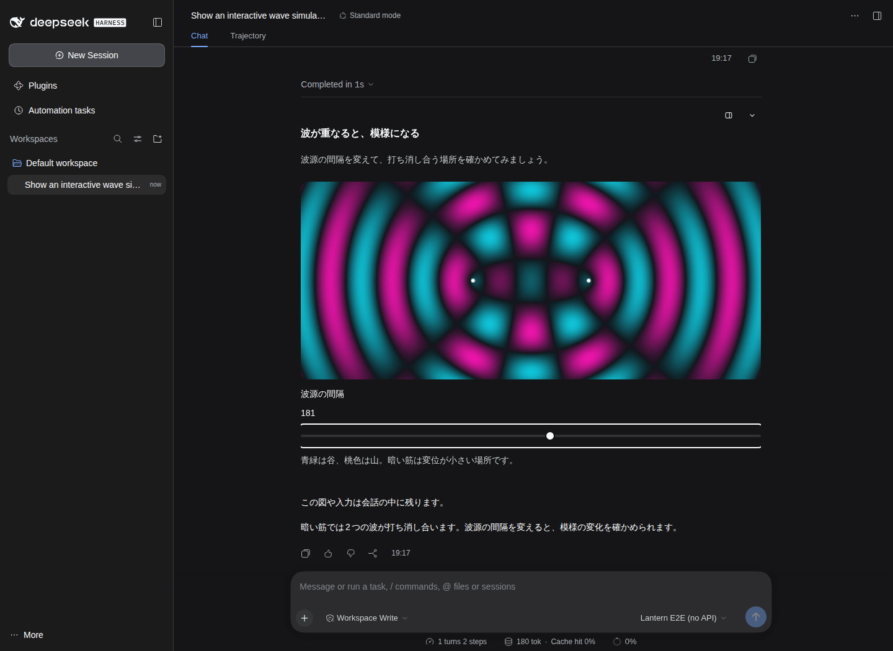
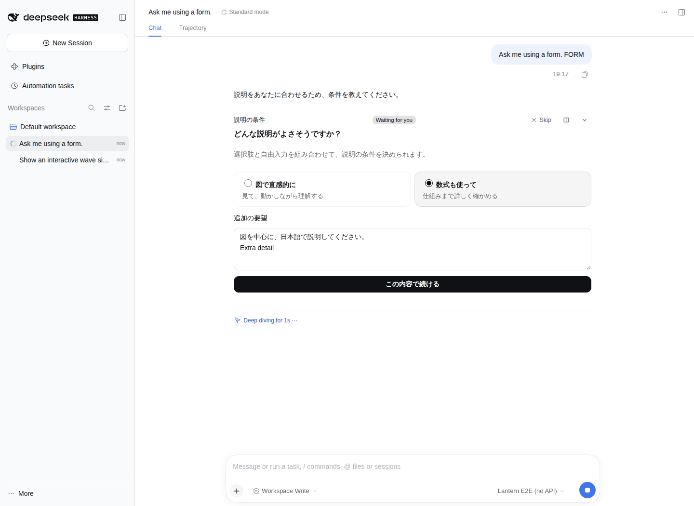
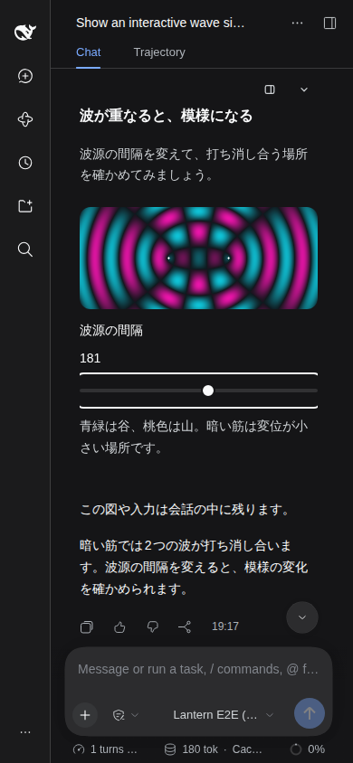
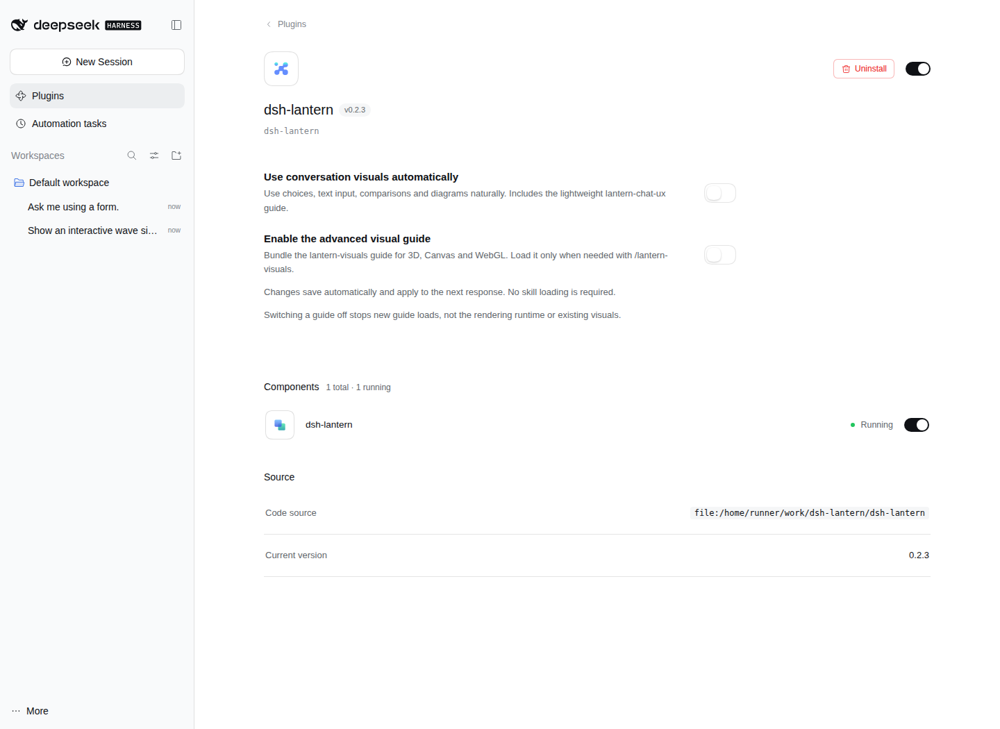

# シームレス会話UIの検証

## 実行対象

- 公式 `@deepseek-ai/dsh@0.2.1-rc.2`、Node 22.23.3、Playwright 1.55.1 / Chromium。
- 検証した製品コード: `464bba8cf67e6fb7c63008934f01cd378ad542a3`。後続の整理コミットは説明・証拠・検証用設定の削除のみです。
- [実行結果](https://github.com/Aero123421/dsh-lantern/actions/runs/39660187182) / [機械可読な検証記録](results.json)。
- モック画面ではなく、公式DSHを起動してプラグインを読み込んだ実画面です。モデルだけは決定的なテストアダプターです。ユーザーのAPIキー、アカウント、会話データは使用していません。

## 結果

| 検証 | 結果 |
|---|---|
| 型チェック・既存/回帰テスト・ビルド | 89テスト成功 |
| 実iframeランタイムのChromium検証 | 24項目成功 |
| 公式DSHとのブラウザ結合検証 | 22項目成功 |
| WebGL2 | sandbox内で描画と画素読み戻し成功 |

会話ノードの位置、末尾の重複なし、枠なし、ライト/ダーク追従、390px表示、履歴再表示時の停止、明示実行後の操作状態復元、サイドバーへの状態引継ぎ、フォーム回答で待機中モデルが再開する経路、確定回答の再表示、2つのガイドの独立切替、無効ガイドのカタログ除去、OFF時も描画ツールが残ることを確認しました。

ランタイムでは320px表示、必須入力、改行、IME変換イベント、連打防止、通信失敗と再送、入力保持、特殊なフィールド名、パスワード復元の除外、親DOMへのアクセス遮断、独自CSS/SVG、通常コンテンツと100vhページの高さ処理を検証しています。

## 実画面

### DSHダークテーマ・会話内の可視化

### 選択肢と自由入力

### モバイル幅

### 2つのガイドをOFF

## 分かった不具合と修正

通常の縦積みUIを100vhアプリと誤判定し、iframeの高さを固定して見出しが切れる問題を再現・修正しました。縦flex内でスライダーが不自然に高くなる問題も修正しました。また、iframe要素と内部文書のcolor-schemeが食い違うと透明指定でも暗い背景が描かれるため、実際のテーマ変更と同期しています。

## 検証の境界

- 配置は「文章のステップ → UI → 次の文章のステップ」です。1つのMarkdown本文の任意段落へのアンカー挿入ではありません。先行文はDSH標準の折りたたみ規則に従います。
- 実LLMでの自発的なUI利用率、生成品質、トークン節約率は測定していません。テストアダプターは意図的にshow_visualを呼びます。
- IMEはcompositionイベントの自動検証です。OSネイティブ候補ウィンドウの手操作検証ではありません。
- WebGL2はヘッドレス環境の描画確認で、物理GPU性能や全3Dライブラリの互換性を保証するものではありません。
- Chromiumの既知の `navigate-to` 未対応警告と、履歴停止中のscript実行拒否メッセージは生ログに残しています。これら以外のブラウザエラーは検出されませんでした。隔離や送信条件を緩めてはいません。
- 依存取得中にnpmの外部パッケージ配布が404になった試行があり、成功済みの隔離DSH依存スナップショットを再利用して最終検証しました。

一時的な取得・書込み用Actionsワークフローは最終差分から削除しました。再実行用スクリプトは `test/browser/` に残しています。
