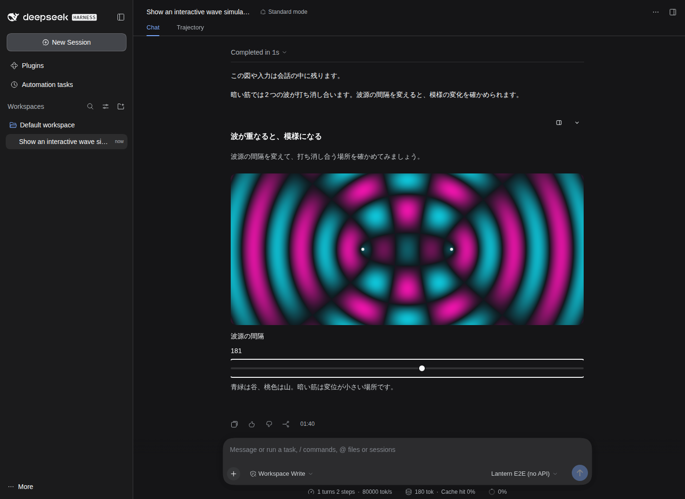
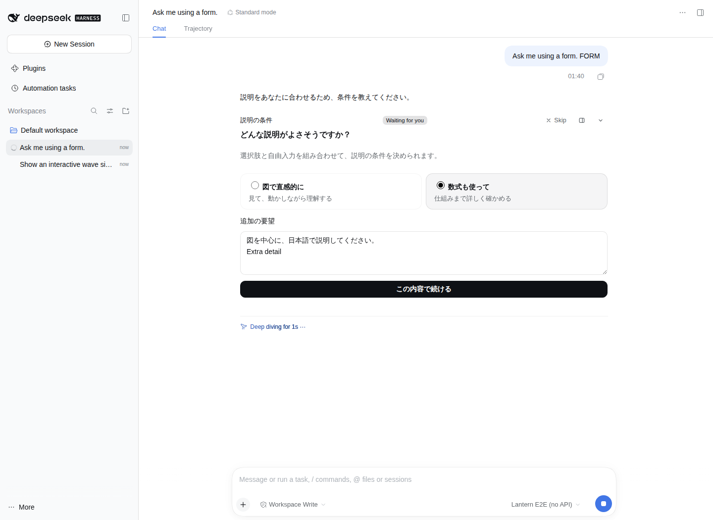
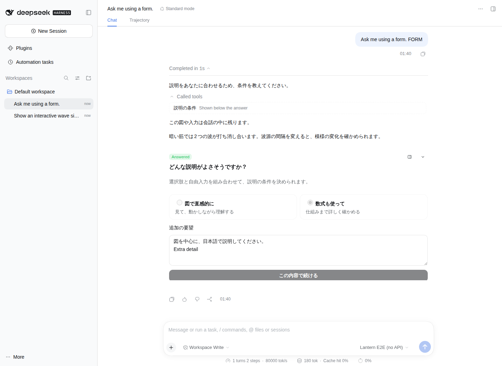
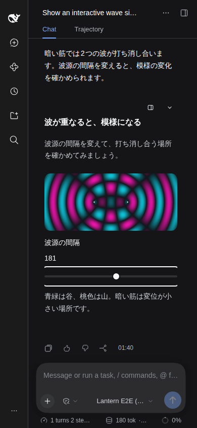

# 回答末尾表示への復元と再検証

表示位置を従来方式に戻しました。処理中のプレビュー・回答待ちフォームはツール欄、完了後のUIは最終回答の末尾に表示します。両SKILLとシステム指示から、文章を分割してUIを挟む誘導を削除しました。枠なし表示、配色修正、自由入力、2つのSKILL切替、リッチな描画基盤は維持しています。

## 結果

公式DSH 0.2.1-rc.2、Node 22、Playwright 1.55.1 / Chromiumで検証しました。モデルのみ決定的なテストアダプターです。

- 型チェック・90テスト・ビルド成功。
- iframeランタイム: 24項目成功。
- 公式DSH: 24項目成功。

最終回答の後への配置、独立会話ノードなし、枠なし、ライト/ダーク、390px幅、履歴とスライダー状態復元、サイドバー、回答待ちフォームの入力・送信・モデル再開、末尾への移動と重複なし、確定回答復元、2つのガイド切替を確認しました。

[検証実行](https://github.com/Aero123421/dsh-lantern/actions/runs/39706934236) / [生のチェック一覧と製品ファイルのSHA-256](results.json)。前の会話途中表示の検証記録は過去の設計の証拠です。現在の配置はこの記録を参照してください。

## 実画面

## 検証の境界

実LLMの自発利用率、OSのIME候補ウィンドウ、物理GPU性能は測定していません。DSH標準の処理履歴の折りたたみ自体は変更していません。既知のCSP警告と履歴停止中のスクリプト拒否は生ログに残しています。一時的な検証用ワークフローは差分から削除し、再実行手順はtest/browser/README.mdに残します。
